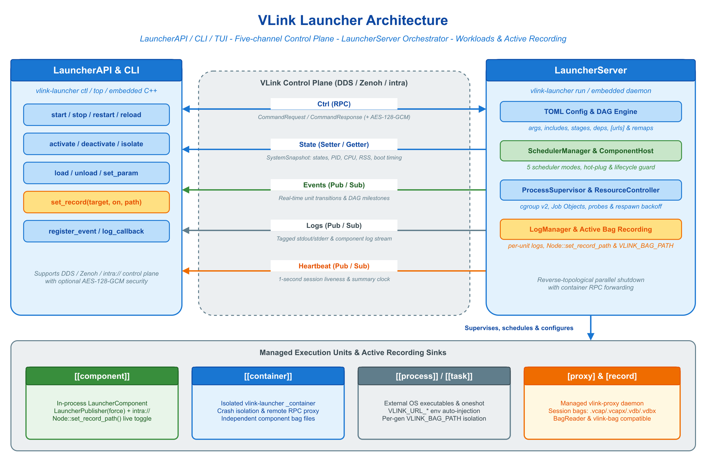
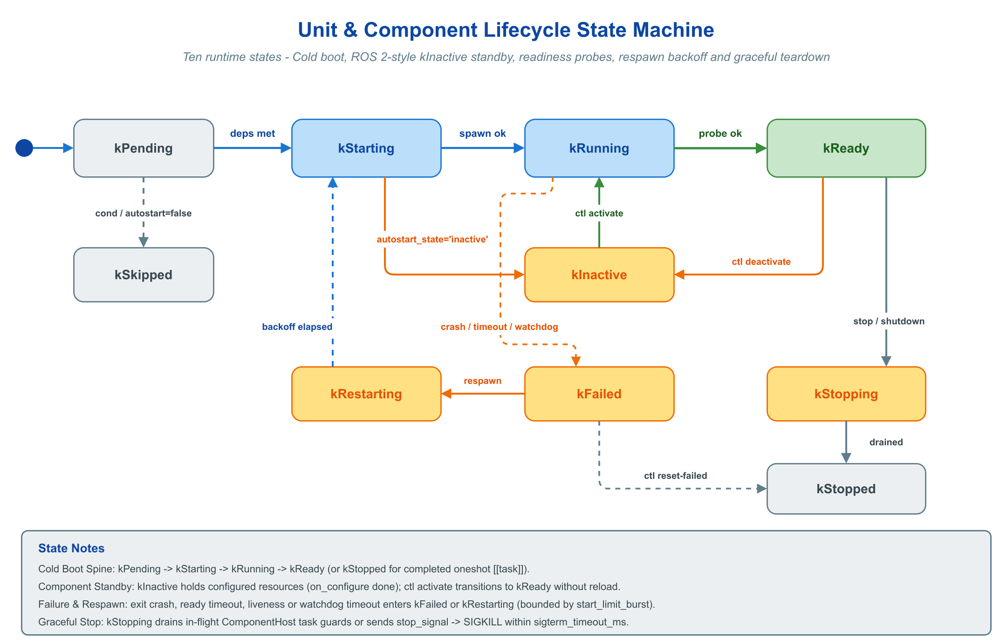
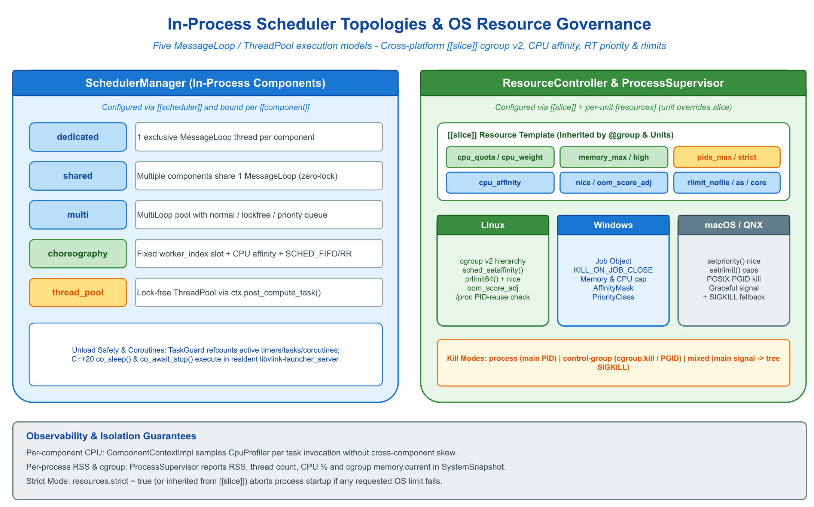
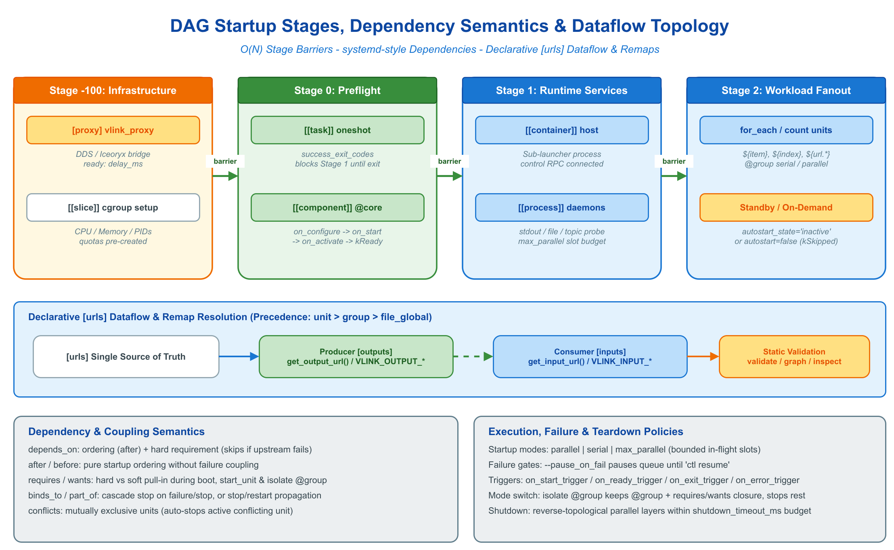
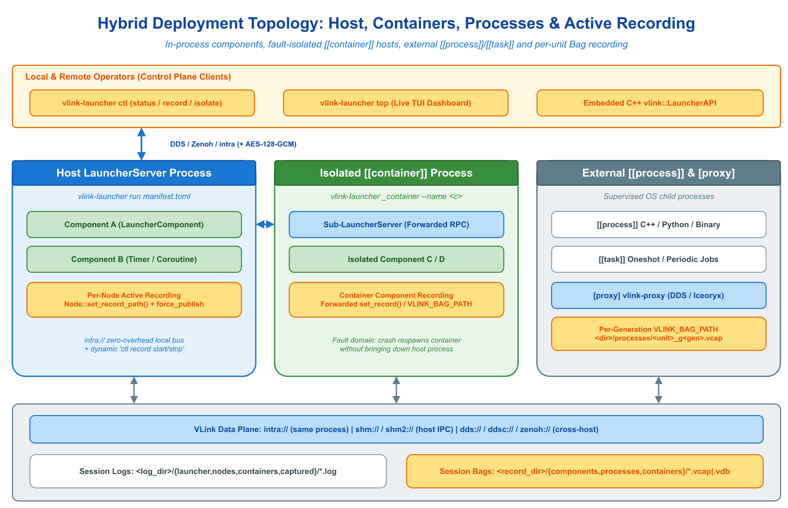

# 🚀 11. Launcher 编排与进程守护

VLink Launcher 是位于 `src/external/launcher_api/` 与 `include/vlink/external/` 的独立系统编排、进程内组件容器与进程守护子系统。它使用声明式 TOML（`thirdparty/tomlplusplus`）描述系统拓扑，融合了 **ROS 2 Launch** 的声明式组合与托管生命周期（`Active` / `Inactive`）、**Apollo CyberRT Mainboard** 的进程内零拷贝组件调度，以及 **Linux systemd**（`systemctl` / `journalctl` / `systemd-analyze` / cgroup v2）的依赖状态机、资源治理与诊断工具链。

---

## 🧭 11.1 架构总览与核心定位



### 构建产物与模块边界

| CMake 目标 / 产物 | 头文件入口 | 职责 |
| --- | --- | --- |
| `vlink::launcher_api` | `include/vlink/external/launcher_api.h`、`launcher_component.h` | 控制面数据模型、客户端 SDK（`LauncherAPI`）及零第三方依赖的组件插件 ABI |
| `vlink::launcher_server` | `include/vlink/external/launcher_server.h` | 嵌入式编排引擎、调度器、进程守护、资源管控与容器托管 |
| `vlink-launcher`（软链 `launcher`） | `src/external/launcher_api/launcher.cc` | 独立 CLI、实时 `top` TUI、静态校验、离线日志查询与控制面工具 |

- CMake 开关：`ENABLE_LAUNCHER=ON`（默认开启）；当同时开启 `ENABLE_PYTHON_API=ON` 时，原生 Python 绑定同步导出 `vlink.LauncherAPI`、`vlink.LauncherServer` 与 `vlink.launcher` 子模块（与 C++ 控制面及嵌入式编排接口功能对齐）。
- **零侵入可选接入**：`[[process]]` 外部进程与既有 `vlink::RunablePluginInterface` 插件均**无需** `#include <vlink/external/launcher_component.h>`（存量 `RunablePluginInterface` 插件在清单中显式设置 `legacy = true` 即可直接托管，仅按需牺牲动态参数、看门狗与热重载等扩展能力）。需要进程内多类多实例与完整增强能力时，只需包含 `<vlink/external/launcher_component.h>` 并链接 `vlink::vlink`，无需引入 `tomlplusplus` 或 `launcher_server`。
- **非阻塞控制面**：控制面 RPC 挂载于独立 4 线程 `vlink::MultiLoop` 上并发处理，不再阻塞 `LauncherServer` 主编排事件循环；启动等待通过 `vlink::ConditionVariable` 零轮询唤醒，控制面载荷基于 `bitsery` 零冗余编码。

---

## 🧩 11.2 五大统一载体与托管生命周期

Launcher 将系统中的全部运行实体统一建模为 `Unit`（`UnitType`）：

| 载体 | TOML 段 | 运行方式 | 适用场景 |
| --- | --- | --- | --- |
| 外部进程 | `[[process]]` | `vlink::Process` + `ResourceController` | 独立二进制、Python/Rust/C++ 异构服务、故障强隔离 |
| 进程内组件 | `[[component]]` | `vlink::Plugin` + `ComponentHost` | 低延迟零拷贝、多类多实例、共享调度线程池 |
| 隔离容器 | `[[container]]` | 受管子进程 `vlink-launcher _container` | 将一组组件隔离在独立地址空间与 cgroup 内 |
| 编排任务 | `[[task]]` | `oneshot` / `periodic` | 启动前检查、标定脚本、周期性巡检任务 |
| 代理边车 | `[proxy]` | 受管 `vlink-proxy` 进程 | 自动拉起与守护同域服务发现代理（默认 `stage = -100`） |



### 组件基类矩阵与托管生命周期

| 基类 | 宏 / 门控 | 典型用途 |
| --- | --- | --- |
| `vlink::LauncherComponent` | 始终可用（C++17+） | 通用生命周期组件（`on_configure` / `on_start` / `on_activate` / `on_deactivate` / `on_stop` / `on_cleanup` / `on_reload` / `on_param_changed`） |
| `vlink::LauncherTimerComponent` | 始终可用（C++17+） | 类 CyberRT `TimerComponent`，自动解析 `interval_ms`/`period_ms`、绑定 `vlink::Timer` 并自动喂狗；进入 `kInactive` 自动暂停定时触发，`activate` 自动恢复 |
| `vlink::LauncherCoroutineComponent` | `#ifdef VLINK_ENABLE_COROUTINE` | 声明式 C++20 协程组件，只需实现 `Co::Task<void> on_coro_run(LauncherContext&)`，热卸载自动取消并等待协程安全退出 |
| `vlink::RunablePluginInterface` | 兼容旧插件 | 置 `legacy = true` 或留空 `class` 自动回退，零改造托管既有 VLink 插件 |

- **ROS 2 级待机/激活切换（`kInactive` <-> `kReady`）**：
  - 组件配置 `init_state = "inactive"` 时，启动仅执行 `on_configure` 后直接驻留 `kInactive` 待机态（不跳过配置预热、不发射业务流量，仍支持运行期 `ctl set-param` 预先调参）；首次激活时依次执行 `on_start()` 与 `on_activate()`。
  - 运行期可通过 `vlink-launcher ctl activate <unit|@group>` 与 `ctl deactivate <unit|@group>`（或 `LauncherAPI::activate_unit()` / `deactivate_unit()`）无销毁热切换状态，支持容器内子组件透传与任务组批量切换。
  - 组件停机时若处于激活态，先调用 `on_deactivate()` 再依次执行 `on_stop()`、排空任务与协程，最后执行 `on_cleanup()`。

`LauncherContext` 提供的核心能力：
- 参数读取：`has_param`、`get_param`、`get_param_bool/int/double/string`（支持 CLI 字符串自动数值转换）与 `get_param_*_list`。
- URL 与受管生命周期端口：`resolve_url()`（命名空间 + 边界前缀 remap + 缓存）、`get_url()` / `get_input_url()` / `get_output_url()`、`urls()` / `input_urls()` / `output_urls()`，以及 **`create_publisher<MsgT>()`（`LauncherPublisher`）与 `create_subscriber<MsgT>()`（`LauncherSubscriber`）**——自动解析端口 URL、自动 `attach(&loop())` 序列化回调避免与 `on_reload()`/`on_param_changed()` 竞态、自动按 `is_active()` 门控非激活态收发，并通过共享所有权句柄消除 `ThreadPool` 卸载时的发布器悬空风险。
- 并发调度：`loop()`、`thread_pool()`、`post_task()`、`post_task_handle()`、`post_compute_task()`、`exec_task(Schedule::Config, ...)`、`create_timer()`，以及 C++20 `co_spawn()`、`co_sleep()`、`co_await_stop()`、`co_exec()`。
- 运行治理：`is_active()`、`mark_ready()`、`report_health()`、`watchdog_ping()`、`get_cpu_usage()`、`cancellation_token()`。

---

## ⚙️ 11.3 并发调度、队列与跨平台亲和矩阵



`[[scheduler]]` 将 VLink 基础库的全部执行器与队列原语统一暴露给声明式配置：

| `mode` | 底层 VLink 原语 | 支持 `queue` | 特点 |
| --- | --- | --- | --- |
| `dedicated` | 每组件独占 `MessageLoop` | `normal` / `lockfree` / `priority` | 关键路径零干扰，可独立绑核与设实时优先级 |
| `shared` | 固定 `threads` 个 `MessageLoop` | `normal` / `lockfree` / `priority` | 轻量控制组件共享线程 |
| `multi` | `vlink::MultiLoop` | `normal` / `lockfree` / `priority` | 分发器 + 多线程工作池（注意回调可能在多线程并发执行，组件须自保线程安全；同样支持 `max_elapsed_ms` 超时告警） |
| `pinned`（别名 `choreography`） | N 个绑核 `MessageLoop` 槽位 | `normal` / `lockfree` / `priority` | 类 CyberRT 确定性调度，配合组件 `worker` 固定核槽避免跨核抖动 |
| `pool`（别名 `thread_pool`） | `vlink::ThreadPool` + 锚点 `MessageLoop` | `normal` / `lockfree` | 启动屏障统一调优各工作线程亲和/优先级，组件通过 `pool` 与 `ctx.post_compute_task()` 卸载高吞吐并行计算 |

背压、实时调优与五平台亲和：
- `strategy`：`optimization`（默认，重试后淘汰可丢弃任务）、`pop`（立即淘汰）、`block`（阻塞等待）。
- `cpus`（别名 `cpu_affinity`）：突破 32 核限制——Linux 使用动态 `CPU_ALLOC` + `pthread_setaffinity_np`，Android 使用动态 `CPU_ALLOC` + `sched_setaffinity(0, ...)`，Windows 使用 64 位 `DWORD_PTR` `SetThreadAffinityMask`，QNX 使用原生 `ThreadCtl(_NTO_TCTL_RUNMASK_GET_AND_SET_INHERIT)`，macOS 因系统不提供硬绑核接口而告警降级。
- `policy`（别名 `sched_policy`）：`default` / `other` / `fifo` / `rr`；`priority`（别名 `thread_priority`）：OS 线程优先级；`max_elapsed_ms`：任务排队超时告警阈值（覆写 `MessageLoop::on_task_timeout`）。

---

## 🔀 11.4 systemd 级启动顺序、依赖、阶段屏障与任务组



Launcher 严格区分 **排序边（Ordering）** 与 **依赖语义（Dependency）**，全部支持 `@group` 引用与命名空间自动限定（`/` 前缀表示根命名空间）：

| 字段 | 类别 | 运行时语义 |
| --- | --- | --- |
| `after` / `before` | 排序 | 仅约束启动先后与停止反序，不触发自动拉起或联停 |
| `requires` | 强依赖 | 拉起目标；目标启动失败时跳过本单元，目标显式停止时联停本单元 |
| `wants` | 弱依赖 | 尝试拉起目标，但目标失败不阻塞本单元 |
| `binds_to` | 强绑定 | 包含 `requires`；目标意外崩溃或停止时立即自动停止本单元 |
| `part_of` | 组联停 | 不主动拉起目标；目标停止或重启时单向传播到本单元 |
| `conflicts` | 互斥 | 启动本单元前自动停止冲突单元；同批 `autostart` 冲突在 `validate` 直接报错 |
| `depends_on` | 语法糖 | 等价于 `requires` + `after` |
| `stage` | O(N) 阶段屏障 | 整数阶段号（默认 `0`，`[proxy]` 默认 `-100`）；校验与运行时均通过虚拟阶段屏障推进，避免大规模单元间 $O(N^2)$ 边膨胀 |

### 跨容器依赖提升与并行/串行控制

- **跨容器依赖自动提升**：容器内组件声明指向宿主层单元的依赖或排序边（如 `binds_to = ["lidar_driver"]`）时，编排器自动将对应边提升到宿主 `[[container]]` 单元，确保依赖先后与联停语义在跨进程容器边界上同样成立。
- `[launcher].startup`（别名 `startup_mode`）：
  - `parallel`（默认）：按 DAG 最大并行度启动；`max_parallel = 0` 表示无限制。
  - `serial`：严格串行启动（等价 `max_parallel = 1`）。
  - `max_parallel`：配合 `max_parallel = N` 限制同时处于启动/就绪探测阶段的单元上限。
- 并发槽位由状态机 + `WheelTimer` 异步管理；容器在子控制面就绪后即释放槽位，避免串行模式下父容器与子组件死锁；停机按反拓扑并行有序关停。
- `[[group]]` 任务组（兼具 systemd Target 与 ROS 2 Group 能力）：
  - 支持 `mode = "parallel" | "serial"`（`serial` 自动按成员顺序串联 `after` 边）、`slice`、`after` / `before`、`env` / `remaps` / `params` 继承。
  - 支持 `@group` 批量启停、激活/停用、重启以及 `ctl isolate @group`（停止目标闭包外活跃单元并拉起目标组，适用于行车/泊车/标定/OTA 模式切换）。

---

## 🛡️ 11.5 跨平台资源治理、守护看门狗与生产部署

### `[[slice]]` 与 `[*.resources]`

| 字段 | 范围 / 单位 | Linux cgroup v2 映射 | 无委托降级 / 五平台行为 |
| --- | --- | --- | --- |
| `cpu_quota_percent` | 正整数（100=1核） | `cpu.max`（100000 us 周期） | `strict=true` 报错，否则告警 |
| `cpu_weight` | `1..10000` | `cpu.weight` | 同上 |
| `mem_max_mb` / `mem_high_mb` | 正整数 MiB（`high <= max`） | `memory.max` / `memory.high` | Windows 映射 `JobObject` 内存上限 |
| `pids_max` | `>= 1` | `pids.max` | `strict=true` 报错，否则告警 |
| `cpus` | CPU 编号数组 | `cpuset.cpus` + `sched_setaffinity` | Linux / Android / Windows 无需 root 生效；macOS / QNX 线程亲和 |
| `nice` / `oom_adj` | `-20..19` / `-1000..1000` | `setpriority` / `/proc/<pid>/oom_score_adj` | Windows `nice` 映射优先级类 |
| `nofile` / `vmem_max_mb` / `core_max_mb` | 非负整数 | Linux `prlimit(pid, ...)` | 无需 root 即生效 |

- **Rootless 自动探测与无 cgroup 进程树兜底**：依次检查 `VLINK_LAUNCHER_CGROUP_ROOT`、`/proc/self/cgroup` 当前委托子树与 `/sys/fs/cgroup`。按启动代次创建独立叶子 `<root>/<slice>/<unit>_g<gen>`，避免重启与旧代清理竞态；当普通 Linux/Android 环境无 cgroup 委托时，`kill_mode = "control-group"` / `"mixed"` 自动回退扫描 `/proc/<pid>/stat` 后代进程树与安全进程组（仅当 `getpgid(pid) == pid`），macOS / QNX 使用安全进程组回收，Windows 通过 `JobObject`（`JOB_OBJECT_LIMIT_KILL_ON_JOB_CLOSE`）回收整棵进程树。

### 守护策略、主动录制、Logger 插件（`logd`）与安全边界

- `restart`（别名 `restart_policy`）：`no` / `on_failure` / `on_abnormal` / `always`。
- 防重启风暴熔断：`start_burst` + `start_window_ms` 单调固定窗口（超限标记 `failed_reason = "start_limit"`，可用 `ctl reset-failed` 立即清零），配合 `restart_delay_ms` / `restart_backoff` / `restart_max_ms` 指数退避、`ok_codes` 与 `no_restart_codes`。
- 就绪探针 `[*.ready]`：`none` / `component` / `delay` / `stdout`（仅匹配 stdout）/ `file` / `topic`（通过 `DiscoveryViewer` 精确 URL 匹配）。
- 运行期探活与看门狗：`[*.liveness]`（周期性 `file` / `topic` 探针，连续失败达 `failure_threshold` 自动重启）；组件 `watchdog_ms`（需定期调用 `ctx.watchdog_ping()`）。
- 热重载：`reload = "sighup"`（进程）或 `reload = "component"`（组件 `on_reload()`）。
- **主动 Bag 录制（`[record]` / `ctl record`）**：依托 VLink 原生节点级 `Node::set_record_path()`、`VLINK_BAG_PATH` 与 `LauncherPublisher::publish(msg, force)`，支持在 `[record]`、单单元 `record`/`record_path`/`record_force` 或 CLI `run --record_dir` 开启，并支持运行期 `ctl record start/stop` 动态热切换（跨容器透传、自动按代次/分段命名、`intra://` 安全降级、跨进程路径冲突校验）。
- **内置集中式 `logd` 与原生 Logger 插件（`[logger].plugin`）**：配置 `[logger].plugin = "logd"`（或 CLI `run --log_plugin logd`）即可开箱启用 Launcher 内置 `vlink-launcher_logd`（`LoggerPluginInterface` v1.0）插件与 `LauncherServer` 集中汇聚后端，将宿主、进程内组件、隔离容器与外部 VLink 进程日志经独立会话密钥（启用 `ENABLE_SECURITY` 且传输非 `intra://` 时加密，绝不向普通子进程透传控制面密钥）的 VLink 通道统一写入 `<session_dir>/logd/` 并汇入 `ctl logs`；同时也完整支持加载任意第三方 `LoggerPluginInterface` 动态库，`plugin_strict` 控制 ABI 校验与失败即止/降级，`plugin_capture` 可选汇聚非 VLink 子进程标准输出，`vlink-launcher plugin <lib>` 可直接识别 `LoggerPluginInterface`。
- 控制面安全：`key`（别名 `security_key`）经环境变量 `VLINK_LAUNCHER_SECURITY_KEY` 传递（启用 `SecurityServer` / `SecurityClient`）；非本机未认证网络控制面默认拒绝远程 `ctl load`（返回 `ErrorCode::kUnauthorized`），仅在配置密钥、`intra://`、DDS 显式回环 `bind_ip`（`127.0.0.1` / `::1`）或显式声明 `remote_load = true` 时放行。

### 推荐生产分层部署拓扑



推荐采用 **OS `systemd` + 应用层 `vlink-launcher`** 的分层协同架构：
- **OS 层**：由宿主机 `systemd` 服务负责开机拉起、非 root 用户隔离与 `Delegate=yes` 委托 cgroup v2 子树。
- **应用层**：由 `vlink-launcher` 负责声明式拓扑编排、同进程零拷贝组件调度、故障隔离容器、`isolate @group` 模式切换与远端加密运维。

---

## 📝 11.6 TOML 配置与声明式模板展开速查

- 内置变量：`${arg.<name>}`、`${url.<name>}`、`${env.<VAR>}`、`${this_dir}`、`${cwd}`、`${host}`、`${pid}`、`${os}`、`${arch}`、`${ns}`，以及模板展开变量 `${item}` / `${index}`，全部支持 `${var:-default}` 默认值语法与 `$${...}` 字面量转义。
- **绝对 URL 命名空间免前缀约定**：`scheme:///path`（`://` 后带前导 `/`）在多层级命名空间下显式跳过当前单元 `ns` 自动前缀，并在解析时去掉该前导 `/`（保留 `uds:///...`），便于多层 `[[include]]` 子系统共享规范话题。
- **严格 Schema 校验**：所有 Launcher TOML 表均校验允许键集合与类型，拼写错误、未知字段及标准键/历史别名混写均在解析阶段直接报错。
- **声明式 URL 与端到端数据流编排**：支持在顶层 `[urls]`、`[group.urls]` 以及任意 `[[component]]` / `[[process]]` / `[[task]]` 的 `[*.urls]`、`[*.inputs]`、`[*.outputs]` 中集中定义通讯 URL：
  - **组件插件**：通过 `ctx.get_input_url()` / `ctx.get_output_url()` / `ctx.get_url()` 读取（自动叠加命名空间与 `[remaps]`）。
  - **外部进程 / 任务**：支持在 `args` / `env` / `ready.topic` 中用 `${url.<key>}` 展开，同时自动注入 `VLINK_URL_<KEY>`、`VLINK_INPUT_<KEY>`、`VLINK_OUTPUT_<KEY>` 环境变量（与 `VLINK_URL_REMAP` 协同生效）。
  - **静态拓扑校验与可视化**：`validate` 自动校验 URL 格式并对跨进程/跨容器误用 `intra://` 发出静态告警；`graph`（`ascii` / `dot` / `mermaid`）与 `inspect --json` 自动推导并输出生产者到消费者的数据流拓扑边（`dataflow`）。
- **声明式模板展开（100% 静态可分析）**：`[[component]]`、`[[process]]`、`[[container]]`、`[[task]]`、`[[include]]` 均支持 `for_each = ["front", "rear"]`（或逗号分隔参数 `${arg.cams}`）与 `count = N`（范围 `0..256`，越界直接报解析错误），在解析阶段确定性展开，保持 `validate` / `graph` / `inspect` / `--dry_run` 全链路静态可分析：

```toml
[args.cameras]
default = "front,rear,left,right"

[[component]]
for_each = "${arg.cameras}"
name = "cam_${item}"
lib = "libcamera_driver"
class = "CameraDriver"
scheduler = "perception_pinned"
worker = "${index}"
init_state = "active"
[component.params]
camera_id = "${item}"
channel_idx = "${index}"
```

- 参数声明：`[args.foo]` 支持 `default`、`desc`、`choices` 枚举校验；支持全局 `[env]`、`[remaps]`、`[params]`、`params_file` / `params_files` 与多层 `[[include]]`（含循环检测与独立命名空间）。
- 条件表达式：`condition` 支持布尔值或表达式字符串（支持 `!`、`&&`、`||`、`()`、`==`、`!=`），先按运算符解析 AST 再对原子操作数做变量展开，防止参数值注入逻辑运算符；非布尔/非字符串类型或悬空运算符直接报错。
- 全部 TOML 参数的逐字段类型、默认值、范围、别名与用法详解，请直接查阅 [`src/external/launcher_api/etc/README.md`](../src/external/launcher_api/etc/README.md) 与 [`launcher_example.toml`](../src/external/launcher_api/etc/launcher_example.toml)。

---

## 💻 11.7 CLI、实时 TUI 与离线日志手册

```bash
# 运行与调试开关
vlink-launcher run app.toml --arg profile=sim               # 常规启动与参数覆盖
vlink-launcher run app.toml --dry_run                       # 仅校验并打印分层启动计划
vlink-launcher run app.toml --show_args                     # 查看所有声明参数与默认值
vlink-launcher run app.toml --serial                        # 强制严格串行启动
vlink-launcher run app.toml --parallel 2                    # 限制最大并发启动数为 2
vlink-launcher run app.toml --only @bringup                 # 仅启动目标组及其依赖闭包
vlink-launcher run app.toml --skip noisy_node               # 调试时跳过指定单元或组
vlink-launcher run app.toml --debug_unit driver="gdbserver :1234"  # 挂载调试器前缀
vlink-launcher run app.toml --no_respawn --pause_on_fail    # 禁重启 + 首次失败暂停派发
vlink-launcher run app.toml --record_dir ./bags             # 开启会话主动 Bag 录制
vlink-launcher run app.toml --log_plugin logd               # 启用内置集中式 logd 或加载第三方 Logger 插件

# 静态诊断、离线日志与脚手架
vlink-launcher validate app.toml --check_programs --json    # 校验语法/冲突/环/可执行文件
vlink-launcher graph app.toml --format ascii|dot|mermaid    # 导出依赖图
vlink-launcher inspect app.toml --json                      # 导出完整解析后清单
vlink-launcher logs /path/to/log/session -u driver --grep ERR -n 200  # 离线查询落盘日志
vlink-launcher plugin libdemo_launcher_components.so        # 检查动态库导出的组件类
vlink-launcher init --template systemd -o stack.toml        # 生成起步模板
vlink-launcher completion bash                              # 生成 bash/zsh 自动补全

# 实时交互式 TUI 仪表盘（j/k 选中, s 启动, x 停止, r 重启, o 重载, b Blame排序, l 日志, q 退出）
vlink-launcher top

# systemd / journalctl / systemd-analyze 风格控制面
vlink-launcher ctl status [--watch] [--json]                # 全系统总览与实时 CPU/RSS/启动耗时
vlink-launcher ctl status driver                            # 单单元详情卡（状态/PID/cgroup/依赖/最近10行日志）
vlink-launcher ctl list-units --failed                      # 按类型/状态/组/失败筛选
vlink-launcher ctl list-dependencies driver [--reverse]     # 依赖树可视化
vlink-launcher ctl blame                                    # 按启动耗时降序排行（含柱状图）
vlink-launcher ctl critical-chain [driver]                  # 关键启动路径瓶颈分析
vlink-launcher ctl cat driver                               # 查看解析后的生效配置
vlink-launcher ctl logs -u @bringup -n 50 -f --level warn --grep timeout
vlink-launcher ctl start|stop|restart|reload|activate|deactivate|reset-failed <unit|@group>
vlink-launcher ctl isolate @bringup                         # 隔离切换运行组
vlink-launcher ctl resume                                   # 恢复 --pause_on_fail 暂停的启动队列
vlink-launcher ctl load -u c1 --lib my_mod --class MyComp --scheduler rt_ctrl --worker 0
vlink-launcher ctl unload -u c1
vlink-launcher ctl params -u c1
vlink-launcher ctl set-param -u c1 interval_ms=200          # 自动类型推断（支持 bool/int/double/list/string）
vlink-launcher ctl record start -u c1 [--path out.vcap]     # 动态开启/切换组件主动录制
vlink-launcher ctl record stop -u c1                        # 动态停止组件主动录制
vlink-launcher ctl shutdown
```

---

## 🧪 11.8 验证说明与示例入口

- 单元测试位于 `test/launcher/launcher_test.cc`，覆盖参数无损编解码、短键与兼容别名校验、TOML `[urls]`/`inputs`/`outputs` 数据流推导与跨进程 `intra://` 校验、`LauncherPublisher`/`LauncherSubscriber` 生命周期受管端口门控、主动录制（含 `force_publish`、`ctl record`、`intra://` 安全降级与 `BagReader` 落盘验证）、原生 Logger 插件（`logd` / `LoggerPluginInterface` 加载、严格失败与降级、子进程透传与 `inspect_plugin`）、`TaskHandle` 异常失败契约、动态 `load_component` 端口绑定与 `get_unit_config` 实时导出、`for_each`/`count` 模板展开、systemd 依赖与跨容器/跨阶段投影环校验、`pinned`/`shared`/`pool` 调度器（含 `lockfree`）、`LauncherTimerComponent`、`LauncherCoroutineComponent`（C++20 启用时）、`on_reload`、`activate`/`deactivate`、`isolate`、`start_limit` 熔断、`binds_to` 联停与 `LauncherAPI` 控制面。
- 示例工程位于 `examples/launcher/`（含 4 套独立可构建示例，各带独立 `README.md` 与架构说明）：
  1. `component_pipeline/`（`demo_launch.toml` + `demo_components.cc`）：进程内零拷贝感知-融合-控制流水线（`[urls]` + `pinned`/`pool` + 主/备热切）。
  2. `hybrid_dataflow/`（`hybrid_dataflow.toml` + `sensor_node.cc` / `actuator_node.cc` / `planner_plugin.cc`）：多进程 + 隔离容器插件 + RPC 混合数据流（`stage 0..3` + `[[slice]]` + `for_each` + `VLINK_*` 环境变量注入）。
  3. `embedded_orchestrator/`（`embedded_orchestrator.cc` + `embedded_components.cc` + `embedded_orchestrator.toml`）：全自包含的 C++ 嵌入式 `LauncherServer` + `LauncherAPI` 编程式编排、主备热切、`isolate_group` 模式隔离、热插拔与异步停机。
  4. `nested_includes/`（`system_root.toml` + `subsystems/*.toml`）：3 层递归 `[[include]]`、`namespace` 逐级叠加、`for_each`/`condition` 子系统展开、嵌套 `[params.*]` 展平与绝对 URL 跨子树共享。
- 完整生产参考配置模板与逐参数参考手册位于 [`src/external/launcher_api/etc/launcher_example.toml`](../src/external/launcher_api/etc/launcher_example.toml) 与 [`src/external/launcher_api/etc/README.md`](../src/external/launcher_api/etc/README.md)。

---

## 📚 相关文档

- [基础库](08-base-library.md)：`MessageLoop`、`MultiLoop`、`ThreadPool`、`Timer`、`Process` 与 `Logger` 原语
- [CLI 工具](10-cli-tools.md)：10 个运行时与录制调试命令行工具
- [可视化](12-visualization.md)：桌面 Viewer 套件与 WebViz（Foxglove / Rerun）
- [可观测性](13-observability.md)：服务发现与 `vlink-proxy` 代理监控
- [集成与扩展](14-integration.md)：插件接口、C / Python 绑定与 `VLINK_*` 环境变量
