<div align="center">


# VLink v3.0.0 技术白皮书

### 面向自动驾驶与具身智能的高性能通信与整机编排底座

*Apache 2.0 开源协议 | 支持 C++17 / C++20、Python 与纯 C ABI | 覆盖 Linux、QNX、Android、Windows 与 macOS*

官方网站：<https://vlink.work>　｜　开源仓库：<https://github.com/thun-res/vlink>　｜　配套生态：[VKit](https://github.com/thun-res/vkit) / [VMsgs](https://github.com/thun-res/vmsgs)

</div>

---

## 引子：从一次地下车库实车联调看量产域控的通信困局

晚上十一点，地下车库里的实车正在联调。算法、中间件和嵌入式三个组围着一台笔记本盯 `htop`，感知同事报出一个典型的现场问题：“BEV 模型单帧推理只要 18 毫秒，整条感知链路端到端延迟却飙到了 70 多毫秒。”

顺着 trace 往回查，根因并不在神经网络本身：8 路 8MP 相机加 128 线激光雷达在采集、前处理、感知和落盘四个进程之间反复序列化、拷贝和跨核搬运，把 DDR 内存带宽和 CPU 三级缓存吃掉了大半。更棘手的是系统内部五套协议并存——域控主芯片跑共享内存，跨板走 Fast-DDS，底盘控车按车厂规范走 SOME/IP，座舱渲染在 Android 上跑 FDBus，数据回传和远程调试还要接 MQTT 或 Zenoh。平时各模块用着五套互不兼容的 API 和序列化工具，一到联调全靠桥接进程硬粘；在开发机跑端到端单元测试，不先把 RouDi、DDS 域和配置文件配齐，进程根本起不来；上车启动几十个节点全靠一团 `nohup ... &` 配 `sleep 3` 的 Shell 脚本硬顶，哪个调试脚本内存泄漏把规控进程 OOM 拖死、哪个孙进程退出后变成僵尸，现场几乎无从控起。

ROS 2 在科研原型和开源算法库（Nav2、MoveIt2、TF2 及海量传感器驱动）上的积累无可否认，但把它直接塞进量产域控、QNX 安全核或者高频人形机器人本体时，结构性短板会立刻暴露：单个 Fast-DDS 示例二进制接近 1 MB 并拖带 **102 个动态库**；30 个 FastDDS UDP 节点空载拉起就要吃掉 **816 MB 内存和 300 条线程**、全网收敛耗时 **679 ms**；哪怕底层加载物理完全相同的 Eclipse Iceoryx 2.0.5 共享内存库（ROS 2 CycloneDDS + Iceoryx），因为上层序列化与 `rmw` 抽象没有打通，跨进程传递 1 MiB 数据依然要花 **1,028.8 µs**，16 MiB 原始帧更是飙到 **6.41 ms**。此外，ROS 2 既无法在同一份代码里统一调度 SHM、DDS、SOME/IP、FDBus 与 Zenoh，也缺乏跨进程 GPU/DMA-BUF 显存共享、车端恒定内存触发黑匣子以及非 root cgroup v2 资源隔离编排。

**VLink v3.0.0** 正是为解决这一整套量产工程难题而生。它是一套全自研通信内核与全栈工程底座，覆盖统一通信原语、10 种传输后端、两层零拷贝与跨进程显存共享、无依赖基础库、编译期裁剪的应用层加密、内存触发黑匣子、**v3.0.0 新增的整机编排引擎 `vlink-launcher`**、防回环观测代理、10 个终端 CLI 以及 Qt / Foxglove / Rerun 双模可视化。

### 与 ROS 2 的全方位架构与能力对照

在展开各模块源码设计之前，下表从量产落地最关键的八个维度，直接对照 **VLink v3.0.0** 与 **ROS 2（Humble 典型部署）**（通信实测数据来自仓库 `.github/perf/vlink_vs_ros2_report.html` 已归档的 `v2.4.0 @ 9d880ba` 6/6 物理同库基准，v3.0.0 尚未重跑全量对比，供架构性能参考）：

| 核心维度 | ROS 2（Humble 典型部署） | VLink v3.0.0 核心优势 | 6/6 同库实测或工程验证结果 |
| :--- | :--- | :--- | :--- |
| **传输后端与协议统一** | 强绑定 DDS / RMW 抽象；跨 SOME/IP、FDBus、MQTT 须维护独立桥接进程 | 一个 URL 统一路由 10 种传输后端（含无守护 Rust Iceoryx2、AUTOSAR SOME/IP、FDBus、Zenoh、MQTT）；内置原生 XCDR | 换传输后端不改业务代码，支持 `VLINK_URL_REMAP` 免重编改拓扑；直通原生 ROS 2 节点，无需独立 `ros2_bridge` |
| **主机零拷贝与 GPU 显存** | `loan_message` 仅限固定 POD；CycloneDDS + Iceoryx 上层仍拷贝；无跨进程显存方案 | 变长 RAII Loan 结合 9 类冻结线格式感知容器；`FastBuffer` 跨进程共享 GPU 显存与车规 DMA-BUF（CUDA / HIP / `hbmem`） | 同库 Iceoryx 1 MiB 延迟 **47.1 vs 1,028.8 µs（快 21.8 倍）**，有效载荷吞吐 **35,657 vs 1,115 MiB/s（高 32.0 倍）**；同机共享句柄无附加元数据时控制信封仅 **140 B** |
| **序列化与多语言协同** | 依赖 IDL 预生成与 `rclpy` 拷贝开销；开源 `vsomeip` 缺失序列化引擎 | 编译期 `if constexpr` 自动推导 15 种受支持类型分支；配 R25-11 ARXML 生成器；Python `nanobind` PEP 3118 与 `FastBufferPool` 零拷贝绑定 | 同库 FastCDR 324 B IMU **0.11 vs 0.79 µs（快 7.2 倍）**；扩展零拷贝 720p 反序列化 **0.04 µs**；C++ 感知与 PyTorch VLA 进程隔离且显存直通 |
| **基础库与 P99 尾延迟** | 多层 `rclcpp → rcl → rmw` 调度加外部同步日志；高频大载荷易触发分配器抖动 | 全自研无依赖基础库：128 B 双缓存行 `Bytes`、19 档分片 `MemoryPool`（锁外 `trim()`）、异步低竞争日志、池化 C++20 协程 | 同库 FastDDS SHM 1 MiB 压测 P99 **255.4 vs 9,019.0 µs（收敛 35.3 倍）**；4 线程并发写盘 **3.39M vs 0.72M msg/s（高 4.7 倍）** |
| **整机编排与资源隔离** | `ros2 launch` 为 Python 进程拉起脚本；缺少跨进程静态告警、组件暖备热切与非 root cgroup | v3.0.0 新增 **`vlink-launcher`**：静态可校验 TOML DAG、5 类托管载体、暖备热切（`kInactive ⇄ kReady`）、强制停机排空与委托 cgroup v2（Linux `Delegate=yes`） | 上车前静态检查依赖环与跨进程 `intra://` 告警；`ctl isolate` 切行泊模式按 `requires` 保底盘桥；分代 cgroup / JobObject 回收后代进程树 |
| **安全加密与事件黑匣子** | SROS2 强绑定 DDS-Security 且 PKI 配置繁重；`rosbag2` 默认偏重持续录放（`--snapshot-mode` 缺每话题独立前后窗与插件回传） | 模板编译期裁剪 Security v2（明文零指令），34 B 固定头 AEAD 信封叠加 5 类 TLS；内建进程内恒定保留环 `TriggerRecorder` | 跨任意后端端到端防窃听防跨话题重放，支持国密 SM2/SM4 回调；同库无压 MCAP 读取高 **1.62 倍**、SQLite WAL 写入高 **2.17 倍** |
| **现场排障与 3D 可视化** | 偏重桌面 RViz2；无内置跨网防回环代理，远程桥接与离线转码易口径漂移 | 10 个零图形依赖 CLI + 四层 `bridge=1` 防回环代理；桌面 Qt 14 类 OSG 3D + 本地外参投影；WebViz 共享核驱动 Foxglove 与 Rerun | SSH 终端快速完成频率、丢包与字段定界；实时流与 `bag2mcap` / `bag2rrd` 离线转码 100% 共用唯一转换逻辑 |
| **跨平台体量与裁剪交付** | 重度绑定 Linux；单 FastDDS 示例 **993.1 KB**、**102 个 `.so`**；30 节点 **816 MB / 300 线程** | 原生覆盖 Linux、QNX 7/8、Android、Windows、macOS；Android AOSP 局部 RTTI 静态库隔离；支持 CMake / Conan / vcpkg 精细裁剪 | 单 FastDDS 示例仅 **48.0 KB（小 20.7 倍）**、依赖 **14 个 `.so`（少 7.3 倍，闭合 21.95 vs 29.17 MB）**；30 节点收敛快 **32%**、省 **293 MB**、少 **90 线程** |

### 国产自主可控与性能之外的多维工程价值

除通信性能与系统体量外，自动驾驶与具身智能量产项目在基础软件选型中同样高度关注**供应链安全、长期可维护性与研发组织效率**。VLink 在这几个维度上提供了与现有海外主流方案及车企封闭自研方案不同的架构路径：

- **自主研发与开源透明**：当前主流通信中间件（ROS 2、Fast-DDS、CycloneDDS、RTI Connext）的核心维护力量均在海外，存在出口管制与上游停供风险；而国内大型企业内部自研的通信框架多为闭源实现，缺乏通用工具链与社区协作。VLink 自有代码（通信抽象、零拷贝容器、`src/base` 基础库、Security v2、`TriggerRecorder`、`vlink-launcher` 与观测可视化）全部自主研发，并以商业友好的 **Apache 2.0** 协议完整开源（第三方依赖遵循各自许可，见仓库 `LICENSE_NOTICES`），代码可审计、可控可演进。
- **传输解耦与防供应商锁定**：业务代码只面向六个通信原语与 URL 契约，底层按已注册 `TransportType` 通过 `TransportPluginInterface` 解耦具体协议栈实现。当某一海外商业或开源传输库出现合规、授权或断供风险时，团队可在不重写上层算法逻辑的前提下切换至其他开源或国产传输实现。
- **国产芯片、国密回调与可控构建链**：`FastBuffer` 显存共享已通过动态插件机制支持**地平线 64 位 Linux 车规 `hbmem` DMA-BUF**（搭配厂商 SDK 打通 CPU / BPU / VPU / ISP 共享内存，核心库不耦合芯片 SDK，可按同一契约扩展更多国产 SoC）；Security v2 提供不依赖 OpenSSL 的自定义加解密回调，便于业务侧对接**国密 SM2 / SM4 与硬件 HSM**；配套构建套件 **VKit** 的核心构建脚本采用纯 Bash + CMake（仅部分主机准备或可选 Rerun 桥接构建期脚本需 Python），便于在受控环境下开展跨平台交叉编译与源码级审计。
- **研发效率、类型安全与可测试性**：15 种序列化分支在编译期静态推导，非法消息类型在编译期由 `static_assert` 拦截，减少运行期故障；借助 `intra://`，算法与业务团队无需配置 RouDi 或 DDS 域即可在单进程 CI 中完成端到端断点调试，上线时再通过 `VLINK_URL_REMAP` 切换部署拓扑。
- **渐进演进与全生命周期运维**：原生 XCDR 直连 ROS 2、ARXML 自动生成 SOME/IP 头文件、MCAP 兼容 Foxglove 生态，使存量团队可以按模块分步迁移而无需推倒重来；配合 `vlink-launcher`、10 个 CLI、防回环代理、桌面 Qt 与 WebViz 以及车端黑匣子，形成从开发、联调、路测到量产运维的完整工程闭环。

---

## 一、统一通信抽象：一个 URL 路由 10 种后端，零桥接直通 ROS 2

底层传输协议在汽车与机器人行业注定长期异构：底盘 ECU 按车厂规范使用 SOME/IP，既有仿真环境运行在 ROS 2 RTPS/CDR 上，QNX 安全核与 Android 座舱常用 FDBus，域控内的高频感知需要共享内存，云边协同需要 Zenoh 或 MQTT。与其发明又一套封闭私有协议，不如把所有协议细节彻底关在传输层以下，让业务代码只面对一套稳定、精简、高性能的通信原语。

### 1.1 三种通信模型、六个模板原语与 URL 路由契约

VLink 将整套通信栈严格分成四层单向依赖，面向业务层只暴露三种通信模型、六个模板类：
- **Event 事件广播**：`Publisher<T>` / `Subscriber<T>`；
- **Method 请求应答**：`Client<Req, Resp>` / `Server<Req, Resp>`（覆盖同步调用、异步回调、`std::future`、服务端异步 `listen_for_reply()` + `reply(req_id, resp)` 以及单向 fire-and-forget）；
- **Field 状态同步**：`Setter<T>` / `Getter<T>`（内置本地末值缓存与变更过滤）。

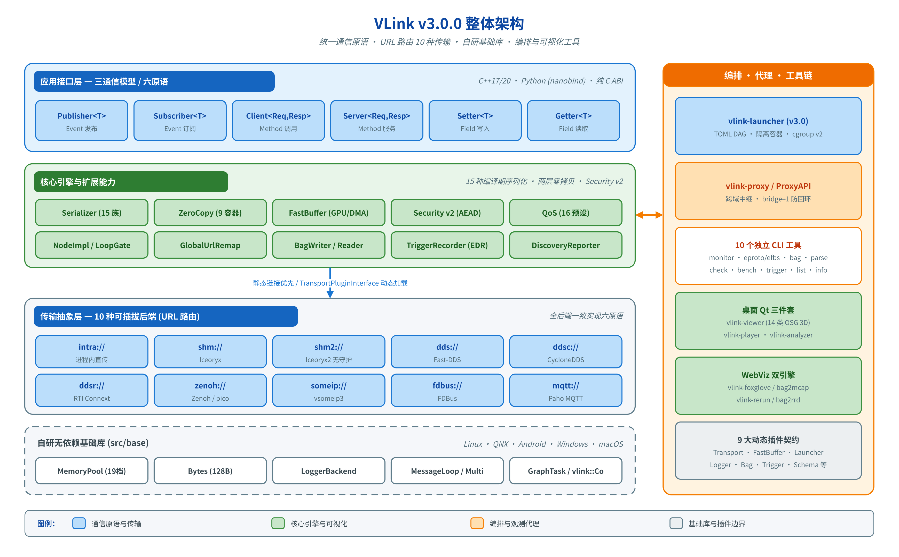

> **图 1**：VLink v3.0.0 整体架构。左侧为四层解耦通信内核与无依赖基础库，右侧为 `vlink-launcher` 编排、防回环代理、10 个 CLI、桌面 Qt 三件套、WebViz 双引擎与 9 类动态插件契约（源文件：[01-vlink-panorama-architecture.drawio](assets/diagrams/01-vlink-panorama-architecture.drawio)）。

相比原生 Fast-DDS 建一个发布者就需要十余行样板代码（尚未计入错误处理、QoS XML 与逆序析构），且切换共享内存后端时整段代码必须推倒重写：

```cpp
// 原生 Fast-DDS：仅建一个发布者，切换至 Iceoryx 共享内存时整段代码必须重写
eprosima::fastdds::dds::DomainParticipantQos pqos;
auto* participant = DomainParticipantFactory::get_instance()->create_participant(0, pqos);
TypeSupport type(new ImuPubSubType());
type.register_type(participant);
auto* publisher = participant->create_publisher(PUBLISHER_QOS_DEFAULT);
auto* topic = participant->create_topic("sensor/imu", "Imu", TOPIC_QOS_DEFAULT);
auto* writer = publisher->create_datawriter(topic, DATAWRITER_QOS_DEFAULT);
writer->write(&imu_sample);
```

使用 VLink 仅需包含单头文件 `<vlink/vlink.h>`，5 行栈对象 RAII 代码即可完成全链路收发（与 `examples/quickstart/hello_pubsub/hello_pubsub.cc` 保持一致）：

```cpp
#include <vlink/vlink.h>

constexpr char kUrl[] = "dds://sensor/imu?qos=sensor";

vlink::Subscriber<ImuData> sub(kUrl);
sub.listen([](const ImuData& msg) { run_fusion(msg); });

vlink::Publisher<ImuData> pub(kUrl);
pub.wait_for_subscribers(std::chrono::milliseconds(500));
pub.publish(imu_sample);
```

在开发机跑 CI 单测时，将 URL 设为 `intra://sensor/imu#direct`，无需安装 DDS 或启动 RouDi，单进程下断点即可走通整条智驾链路；上车同机部署时，通过环境变量 `VLINK_URL_REMAP` 挂载 JSON 规则即可免重新编译切到 `shm://` 或 `shm2://`；跨算力板再切回 `dds://` 或 `zenoh://`。若需要进一步收敛部署体积，开启 `VLINK_TRANSPORT_PLUGINS=auto` 后，运行时会按 URL 协议核对编译期接口 ID 与 SemVer ABI，按需动态加载对应传输插件 `.so/.dll`。同时，`Publisher::publish()` 默认下游无订阅者时直接短路跳过序列化，避免空跑传感器通道白耗 CPU。

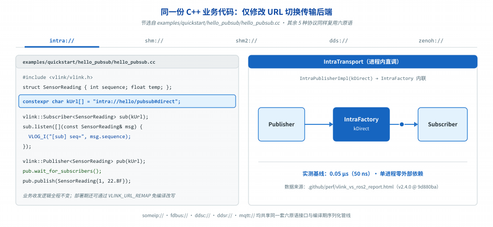

> **图 2**：对应 `examples/quickstart/hello_pubsub/hello_pubsub.cc` 的可编译代码，只修改 URL 即可在五类兼容后端间切换（`someip://`、`mqtt://`、`fdbus://` 同样复用六个原语，按各自协议规范填写地址字段）。

### 1.2 10 种传输后端按物理距离分层覆盖

对比 ROS 2 局限于 DDS / RMW 抽象，VLink 将 10 种主流工业与车规传输后端统一纳入六个原语之下，按物理通信距离分层覆盖从纳秒级进程内到公网云边的全部链路：

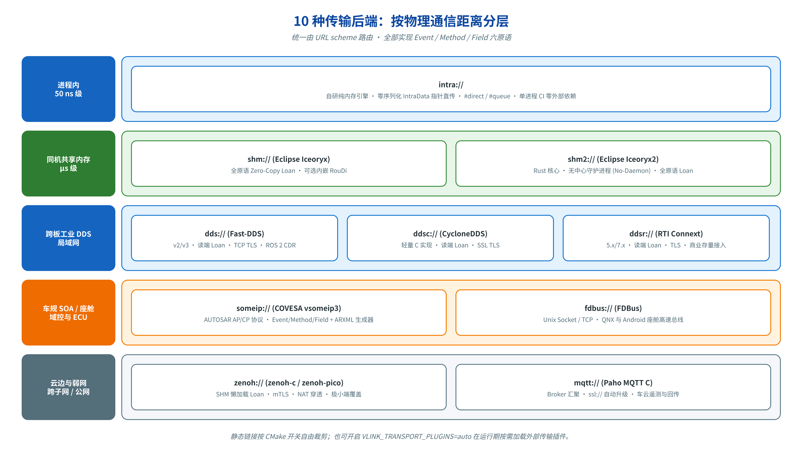

> **图 3**：10 种传输后端的五层部署分布与能力特性（源文件：[04-ten-transports-matrix.drawio](assets/diagrams/04-ten-transports-matrix.drawio)）。

其中两类后端在现代量产架构中尤为关键：一是基于 Rust 内核的 **`shm2://`（Eclipse Iceoryx2）**，彻底去除了中心守护进程 `iox-roudi`，在容器化与故障隔离场景中部署极为干净，1 MiB 饱和有效载荷吞吐实测达 **31,472 MiB/s**；二是 **`zenoh://`**，同时适配支持懒加载 SHM 与 mTLS 的 `zenoh-c` 以及面向极小端的 `zenoh-pico`（开启 `Z_FEATURE_LINK_TLS=1` 支持 TLS），本机 P2P 1 MiB 饱和吞吐达 **4,344 MiB/s**。传输层 `SslOptions` TLS 支持 **MQTT、Fast-DDS、CycloneDDS、RTI Connext、Zenoh** 五类后端，可与上层消息加密正交叠加。

### 1.3 编译期 15 种序列化分支、零桥接直通 ROS 2 与 ARXML 生成

针对团队内部 Protobuf、FlatBuffers、FastCDR、SOME/IP 与 POD 并存的现实，VLink 在 `include/vlink/internal/serializer-inl.h` 中利用 C++17 `if constexpr`、SFINAE 与 `__has_include`，在编译期通过 `Serializer::get_type_of<T>()` 将消息类型静态映射到 **15 种受支持类型分支**（另有 `kUnknownType` 哨兵拦截非法类型并触发 `static_assert`）：包括 `Bytes`、`DynamicData`、`SOME/IP`、`FastCDR / XCDR`、Protobuf 值与原始指针（接收可绑定 Arena）、FlatBuffers Object / 只读 `Table*` / `FlatBuilder`、自定义 `operator>>/<<`（9 类 `vlink::zerocopy::*` 通过 `VLINK_ZEROCOPY_TYPE` 特化走零拷贝）、`std::string`、`char*`、标准 POD 值、平凡标准布局类型指针以及文本流。合法类型全部折叠为静态内联调用，无运行时虚表与字符串查表开销。

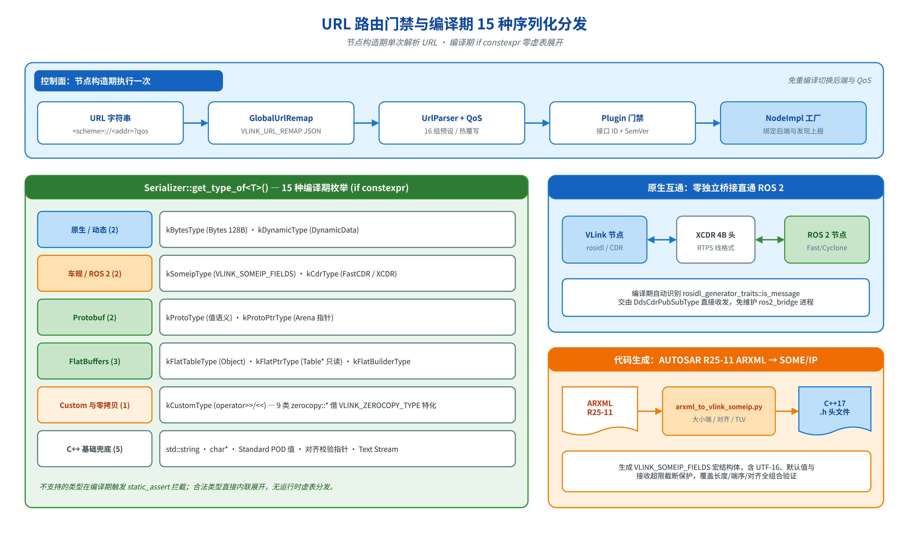

> **图 4**：节点构造期单次 URL 路由门禁与数据面 15 种编译期序列化展开，右侧为原生 ROS 2 XCDR 互通与 AUTOSAR ARXML 代码生成管线（源文件：[03-url-contract-and-compile-dispatch.drawio](assets/diagrams/03-url-contract-and-compile-dispatch.drawio)）。

在这层之上，VLink 专门打通了两个极耗人力的工程断点：
- **免独立桥接直通 ROS 2**：编译期自动识别 `rosidl_generator_traits::is_message` 与 FastCDR 签名，按 XCDR 规范封装 4 字节头部交由 `DdsCdrPubSubType` 直接收发。老系统可以把高实时感知与规控率先迁到 VLink，外围 ROS 2 仿真与驱动节点直接互通，省去维护独立 `ros2_bridge` 进程的延迟与故障点。
- **补齐开源 SOME/IP 序列化短板**：开源 `vsomeip` 只负责收发不带序列化引擎。VLink 内置声明式 `VLINK_SOMEIP_FIELDS` 宏，并配套零第三方依赖脚本 `tools/autosar/arxml_to_vlink_someip.py`，直接读取 AUTOSAR R25-11 ARXML 自动生成带大小端、对齐填充、UTF-16、默认值与接收超限截断保护的 C++17 头文件。

### 1.4 生产级并发防线：LoopGate、变长 RAII Loan 与 16 组 QoS

通信库在量产车上最隐蔽的故障集中在多线程析构、回调重入和共享内存泄漏。VLink 在框架层将这三类边界全部封死：

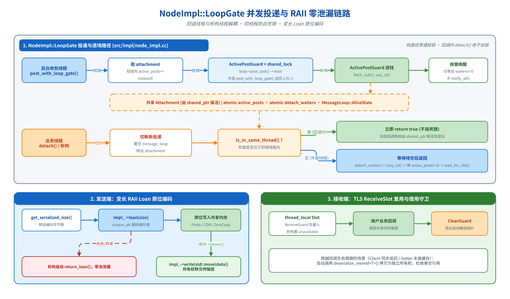

> **图 5**：`NodeImpl::LoopGate` 投递与退场路径、变长消息 RAII Loan 原位编码，以及接收端 `ReceiveSlot` 与 `ClearGuard` 保护闭环（源文件：[02-comm-models-and-loopgate.drawio](assets/diagrams/02-comm-models-and-loopgate.drawio)）。

- **`NodeImpl::LoopGate` 防回调自死锁**：后台收包线程在 `post_with_loop_gate()` 中只在极短锁内取得 `attachment` 并递增 `active_posts`，退出短锁后构造栈上 `ActivePostGuard`，再持 `alive_state` 共享锁调用 `loop->post_task()`（返回 `bool`，外层 `post_with_loop_gate()` 返回 `1 / 0 / -1` 三态）。守卫退栈时执行 `fetch_sub(1, seq_cst)` 并与 `detach()` 侧的原子 `detach_waiters` 构成 Dekker 配对，仅在归零且存在等待者时加锁唤醒，热路径全程零通知锁。业务线程调用 `detach()` 时先置空 `message_loop` 切断新投递，再检查 `is_in_same_thread()`：若正处于回调线程内则立即返回 `true` 绝不自死锁（当前回调栈帧由 `shared_ptr<Attachment>` 保活至退出）；外部线程则等待在途投递归零并调用 `wait_for_idle()` 排空队列。
- **变长消息 RAII Loan 与接收防悬垂**：ROS 2 的 `loan_message` 只能用于固定大小 POD，变长消息仍需先序列化至临时缓冲再拷贝。VLink 在 `Node::serialize_to_transport()` 中先调用 `get_serialized_size()` 估算长度，向 `impl_->loan(size)` 借出物理共享内存并立即交由自定义 deleter 的 `std::unique_ptr` 托管，让 Protobuf、FastCDR 或零拷贝容器原位编码；编码失败或抛异常时析构器自动 `return_loan()`，确保共享内存池零泄漏。接收端复用 `thread_local ReceiveSlot` 并配 `ReceiveGuard` 防回调重入和 TLS 析构顺序冲突，离开回调由 `ClearGuard` 即刻解绑借用指针；`Client` 同步返回与 `Getter` 缓存自动走 `deserialize_owned<T>()` 拷贝为独立所有权。
- **16 组语义化 QoS 预设**：针对原生 DDS 上百种参数极易错配静默失联的问题，VLink 提炼出 16 组 `constexpr QosProfile`（如 `?qos=sensor` 异步旁路、`?qos=best` 刻意采用浅队列 `KeepLast(10)` 防止网络拥塞时重传拖垮消费端），且内置预设默认将 `Deadline` 与 `Lifespan` 保持为 `-1`，避免实车多板数百毫秒时钟漂移导致有效帧被静默丢光；现场需要调整时可通过 `VLINK_QOS_CONFIG` JSON 热覆写。

---

## 二、消除大帧拷贝：主机两层零拷贝与 FastBuffer 跨进程显存共享

按一台典型 L3 自动驾驶配置计算：8 路 8MP（3840×2160）NV12 相机以 30 fps 采集，单路约 12.4 MB，合计 **2.98 GB/s**；叠加一台 128 线激光雷达（4 MB @ 20 Hz），总原始输入超过 **3.06 GB/s**。在传统跨进程路径中，每帧数据需依次经历设备到主机、序列化临时缓冲、跨进程拷贝以及下游反序列化回灌显存四道搬运；每次拷贝包含一读一写双倍 DDR 流量，一对一通信就会白白吞掉 **24 GB/s** 以上内存带宽，扇出到 BEV 感知、泊车和录像三个消费者时额外带宽直接冲破 **40 GB/s**，把 CPU 三级缓存冲刷殆尽。

只把传输层换成共享内存并不能解决问题。在 Ryzen 7 5800X 上加载磁盘同一份 `libiceoryx_posh.so` 2.0.5 对照实测显示：**ROS 2 CycloneDDS + Iceoryx** 跨进程传输 1 MiB 数据仍需 **1,028.8 µs**，有效载荷吞吐停在 **1,115 MiB/s**，16 MiB 大帧延迟高达 **6.41 ms**。底层虽然借用了共享内存，但上层 `rmw` 与通用序列化仍在反复构造中间对象、复制整块字节数组，零拷贝在半路上断掉了。

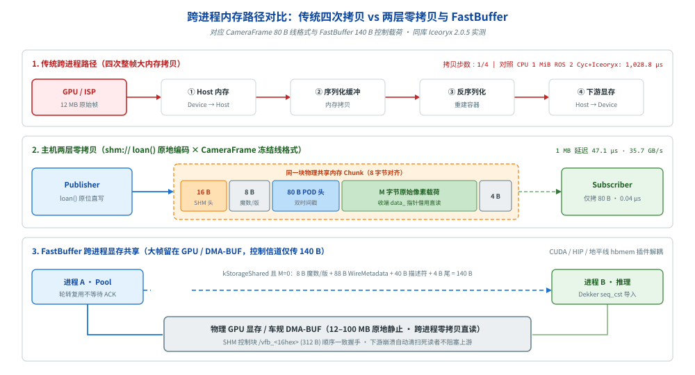

> **图 6**：传统四次拷贝路径与 VLink 主机两层零拷贝、`FastBuffer` 140 B 跨进程显存共享内存流向对比。

### 2.1 主机两层零拷贝：RAII Loan 结合冻结线格式容器

VLink 在编译期将传输层借贷与容器层布局严密咬合为两层零拷贝：
- **传输层原位 Loan**：在 `shm://`、`shm2://` 与开启 SHM 的 `zenoh://` 上，发送端直接借用物理共享页（`shm://` 多借 16 字节前置帧头记录通道号与序号用于全链路丢包统计），编码器直接原位写入，全程不分配临时 `std::vector`。
- **容器层二进制冻结**：针对智驾与机器人中体积最大的 9 类数据设计了 `vlink::zerocopy::*` 容器（公共 40 B `Header` 同时记录硬件采集时间 `time_meas` 与发布时间 `time_pub`，配合 `RawData` 64 B、`CameraFrame` 80 B、`ProxyData` 80 B、`ObjectArray` 112 B 固定头 + 每项 144 B、`AudioFrame` 128 B、`OccupancyGrid` 152 B、`Tensor` 248 B、`PointCloud` 256 B 及 `FastBuffer` 96 B），在 64 位架构下全部通过 `static_assert` 锁死布局与 8 字节对齐。收包时 `Subscriber` 复用 `ReceiveSlot`，仅 `memcpy` 几十到两百多字节的定长头，随即将 `data_` 指针直接借用指向共享内存尾载荷，回调结束由 `ClearGuard` 归还。

在完全相同的 Iceoryx 2.0.5 动态库上，这两层叠加把 1 MiB 跨进程定频延迟从 1,028.8 µs 压至 **47.1 µs（快 21.8 倍）**，饱和有效载荷吞吐拉至 **35,657 MiB/s（高 32.0 倍）**，16 MiB 帧延迟从 6.41 ms 降至 **1.12 ms（快 5.7 倍）**；720p `CameraFrame` 反序列化仅 **0.04 µs**，64K 点云仅 **0.06 µs**。同时配套 `MessageParser` 统一反射读取这 9 类容器，所有 CLI、桌面 Viewer 与 WebViz 共用一套解包逻辑。该路径的适用边界同样清晰：依赖同机借贷型明文后端与 64 位同端序架构（加密与跨机网络须走拷贝路径），借用指针仅在回调内有效，跨回调留存可调用 `deep_copy()`。

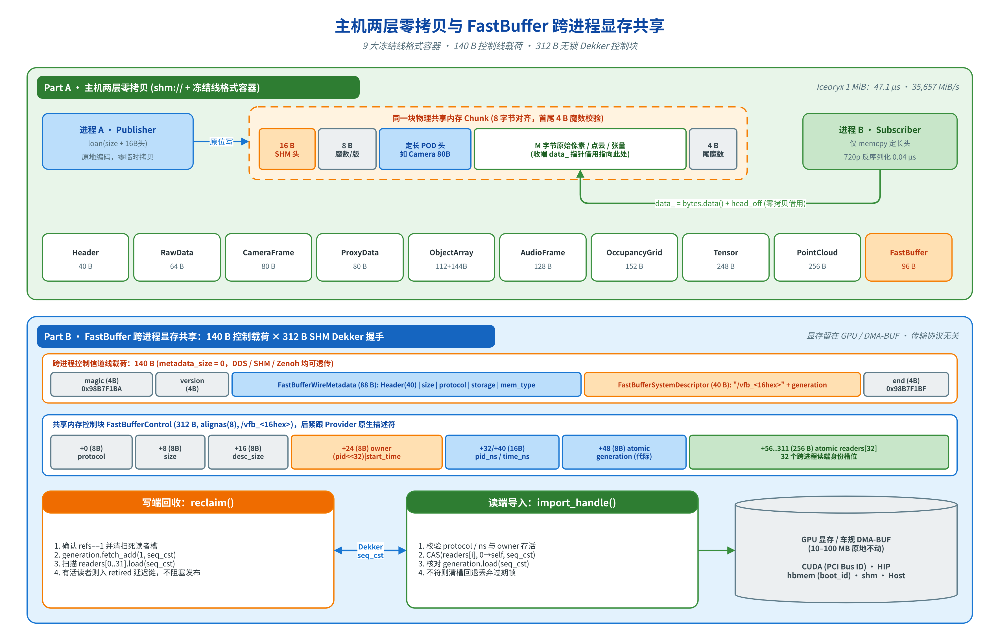

> **图 7**：上方为主机共享内存 Chunk 布局与公共 Header + 9 类冻结容器；下方为 `FastBuffer` 140 B 控制载荷、312 B `/vfb_<16hex>` 共享内存控制块字段偏移与 Dekker 顺序一致握手（源文件：[05-twolayer-zerocopy-and-fastbuffer.drawio](assets/diagrams/05-twolayer-zerocopy-and-fastbuffer.drawio)）。

### 2.2 填补 ROS 2 空白：`FastBuffer` 跨进程 GPU / DMA-BUF 显存共享

在端到端自动驾驶与具身 VLA 架构中，图像经 ISP 输出已经在 GPU 显存或车规 DMA-BUF 内，下游跑 PyTorch / TensorRT 的 Python 推理进程同样在 GPU 上运算。若走主机 `shm://`，依然绕不开 `GPU → Host → GPU` 的 PCIe 往返。

VLink 通过 **`FastBuffer`** 与 **`FastBufferPool`** 让 10 MB 至 100 MB 的图像与张量全程停留在 GPU 显存或车规 DMA-BUF 中原地不动——在同机共享句柄且无附加元数据（`metadata_size == 0`）路径下，跨进程控制信道仅传输固定 **140 字节** 的控制信封（协议无关，DDS / SHM / Zenoh 均可原样透传；8 路 8MP 相机 30 fps 合计控制流不足 34 KB/s）。

生产环境跨进程显存共享的最大风险是**非关键下游崩溃拖死主采集显存池**。VLink 在 `/vfb_<16hex>` 共享内存控制块中设计了 312 字节的无锁 `FastBufferControl`，把回收与导入做成严格的 Dekker `memory_order_seq_cst` 握手：

```text
写端 reclaim()                              读端 import_handle()
────────────────────────────────────────    ────────────────────────────────────────
1. 确认本进程 refs==1 并清扫死读者槽          1. 校验 protocol / pid_ns / time_ns / owner 存活
2. generation.fetch_add(1, seq_cst)   <──>  2. CAS(readers[i], 0 -> self_id, seq_cst)
3. 扫描 readers[0..31].load(seq_cst)        3. generation.load(seq_cst) == decoded.gen ?
4. 若仍有活读者入 retired 延迟链，不阻塞      4. 不等则清槽回退按过期帧丢弃，绝不读到脏页
```

写入 `owner` 与 `readers[32]` 的 64 位进程身份由 `(pid << 32) | fold_start_time(start_time)` 构造，并校验 Linux `pid` / `time` 命名空间，判断死读者时比对 `Utils::get_process_start_time(pid)` 防止 PID 复用与跨容器误判。发布端永远不阻塞等 ACK，有活读者就先挂入 `retired` 延迟链，下游看图工具哪怕 `SIGSEGV` 崩掉也不会卡死主采集帧率。

所有芯片适配均通过 `VLINK_FASTBUFFER_PLUGIN` 动态插件解耦，核心库对任何厂商 SDK 零依赖：
- **NVIDIA CUDA / AMD HIP 插件**：导出描述符携带物理显卡的 **PCI Bus ID** 而非进程内设备序号，接收端按 Bus ID 定位物理卡再打开 IPC 句柄，彻底消除多进程 `CUDA_VISIBLE_DEVICES` 环境变量不一致导致的打开失败；
- **地平线车规 `hbmem` 插件**：打通车载 SoC 的 CPU / BPU / VPU / ISP 共享 DMA-BUF，带 `boot_id` 防重启误导入，`map` / `unmap` 自动维护缓存一致性，并支持 `import_native()` 零拷贝接管相机 SDK 原生缓冲；
- **内置 `shm` 与 `Host` Provider**：空配置默认选用内置 `Host`，显式配置 `shm` 选用共享内存，无 GPU 开发机保持相同业务接口不变。

---

## 三、全自研无依赖底座、应用层加密与内存触发黑匣子

在 Linux、QNX、Android、Windows、macOS 五大平台并行交付以及高频大包压测中，外部日志库与常规堆分配器往往成为多平台 ABI 冲突和 P99 尾延迟失控的根源。VLink 在 v2.2.0 中移除了 spdlog、Quill、DLT 等全部外部日志依赖，将 `Bytes`、内存池、调度器、异步日志与 C++20 协程全部收归自研，并统一接入同一张全局 **`MemoryPool`**。

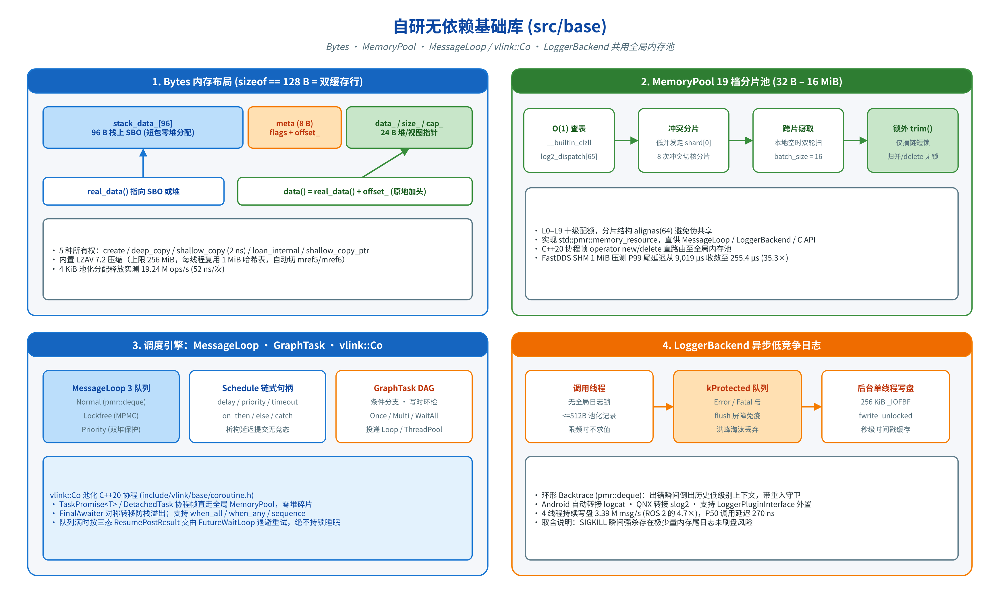

> **图 8**：`src/base/` 四大自研组件的内存布局与并发机制（源文件：[06-self-developed-base-runtime.drawio](assets/diagrams/06-self-developed-base-runtime.drawio)）。

### 3.1 稳住 P99 尾延迟的四块自研底座
- **128 B 双缓存行 `Bytes`**：64 位架构下用 `static_assert` 锁死 128 字节，内嵌 **96 字节栈上 SBO**（大多数控制指令与短 RPC 零堆分配）；前置 `offset_` 支持传输层原地写帧头；`shallow_copy` 约 2 ns，内置 LZAV 7.2 压缩；4 KiB 池化分配释放实测 **19.24M ops/s（52 ns/次）**。
- **19 档自适应分片 `MemoryPool`（32 B – 16 MiB）**：二次幂档位经 `__builtin_clzll` 硬件指令 $O(1)$ 查表；低并发走 `shards[0]` 吃缓存局部性，冲突累计 8 次自动切按核分片，本地耗尽跨片批量窃取 16 块；通过 `MemoryResource` 实现 `std::pmr::memory_resource` 统一供给调度器、日志、C API 与协程帧。`trim()` 仅摘链短锁，将归并全空块与 `::operator delete` 全部移至锁外。在同库 FastDDS SHM 1 MiB 整条路径实测中，ROS 2 的 P99 尾延迟飙升至 **9,019.0 µs**，而 VLink 稳压在 **255.4 µs（收敛 35.3 倍）**，分片内存池与锁外回收是核心架构支撑。
- **`MessageLoop`、`GraphTask` 与池化 C++20 协程**：`MessageLoop` 提供普通、无锁 MPMC 与双堆优先级三种队列（5 ms 定时抖动 P50 仅 1.89 µs）；`Schedule` 链式句柄在析构时延迟提交，消除回调注册与执行线程的竞态；`GraphTask` 支持条件分支与写时环检；开启 C++20 后，`vlink::Co` 将 `TaskPromise<T>` / `DetachedTask` 协程帧的 `operator new/delete` 直路由至全局 `MemoryPool`，靠对称转移防栈溢出，队列满时交由 `FutureWaitLoop` 退避重试，绝不持锁睡眠。
- **异步低竞争日志 `LoggerBackend`**：前端无全局日志锁，512 B 以内走分片内存池直入后台队列，后台单线程以 256 KiB 全缓冲配合 `fwrite_unlocked` 落盘，4 线程并发写盘实测 **3.39M msg/s（ROS 2 `rclcpp` 同步日志 0.72M msg/s 的 4.7 倍）**，调用延迟 P50 仅 270 ns。`Error`、`Fatal` 与 `flush` 屏障带 `kProtected` 标记，满队淘汰只丢低级别日志；`VLOG_*_EVERY_MS` 被抑制时不求值参数，配合环形 `Backtrace` 出错瞬间倒出历史低级别上下文；Android 与 QNX 上可自动转接原生 `logcat` 和 `slog2`。工程取舍上，异步缓冲在进程遭 `SIGKILL` 瞬间强杀时存在极少量内存尾日志未刷盘风险，但换取了常态下绝不阻塞控制回路的确定性。

### 3.2 编译期零代价的 Security v2 信封（对比 SROS2）

SROS2 强绑定 DDS-Security 与复杂的 PKI 权限 XML，一旦切换非 DDS 后端便立刻失效。VLink 将端到端消息加密做成传输无关的应用层 AEAD 信封，并通过模板参数 `SecurityType::kWithSecurity` 在编译期裁剪——**明文节点编译后不生成任何加解密指令**。

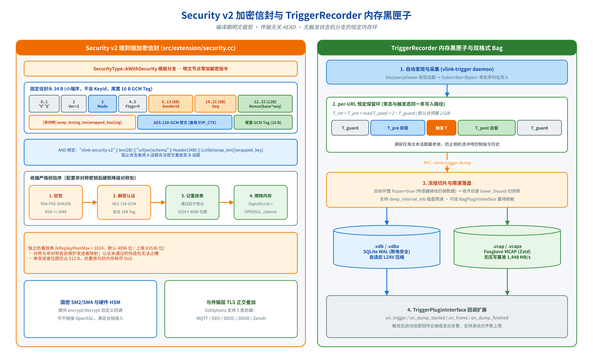

> **图 9**：左半为 Security v2 34 B 固定头、尾置 16 B GCM Tag 与防重放校验链；右半为 `TriggerRecorder` 恒定保留环与双格式 Bag（源文件：[07-security-v2-and-edr-recorder.drawio](assets/diagrams/07-security-v2-and-edr-recorder.drawio)）。

Security v2 固定信封头占 34 字节（小端序，不含 `KeyId`），对称模式复用 `EVP_CIPHER_CTX` 跑 AES-128-GCM，Nonce 由 12 字节随机基数与单调序号异或防重用；非对称混合模式要求 RSA ≥ 2048 bit，固定头后按序排布 `wrap_len`（2 B）、`sig_len`（2 B）、`wrapped_key`、可选 `signature`，最后接密文与 16 B 尾置 GCM Tag。AAD 默认绑定 `"vlink-security-v2" || len(2B) || "url|ser|schema" || Header(34B)`（非对称再拼接 `u16le(wrap_len) || wrapped_key`），阻断跨话题重放。配置非对称密钥后硬拒降级对称包，开启验签时严格先验签、再解密认证，**认证通过后才登记独立防重放表（每表上限 1,024 发送者，默认 4,096 位图、单发送者仅占 512 B，上限可配至 65,536 位）**，退出前由 RAII 擦除密钥与明文。合规场景可挂接国密 SM2 / SM4 或硬件 HSM 自定义回调（可不链接 OpenSSL），并与 5 类后端传输层 TLS 正交叠加，数据穿越公网 Broker 或多层 Proxy 仍保持端到端密文。

### 3.3 车端无分支内存黑匣子 `TriggerRecorder` 与双格式 Bag（对比 `rosbag2`）

`rosbag2` 默认偏重持续录放（虽提供 `--snapshot-mode` 环形快照，但缺少每话题独立前后窗、限速落盘与事件插件回传），路测全量录包每天动辄数 TB，不录又难以捕获偶发急刹或接管现场。VLink 内建 **`TriggerRecorder`**（对应 `vlink-trigger daemon / dump`），以可配置的跨 URL 共享缓存上限（默认 **2 GiB**）在进程内每话题环形队列（`std::deque`）中静默滚存关键话题，收到 RPC 触发后再把前后时间窗完整切片落盘。

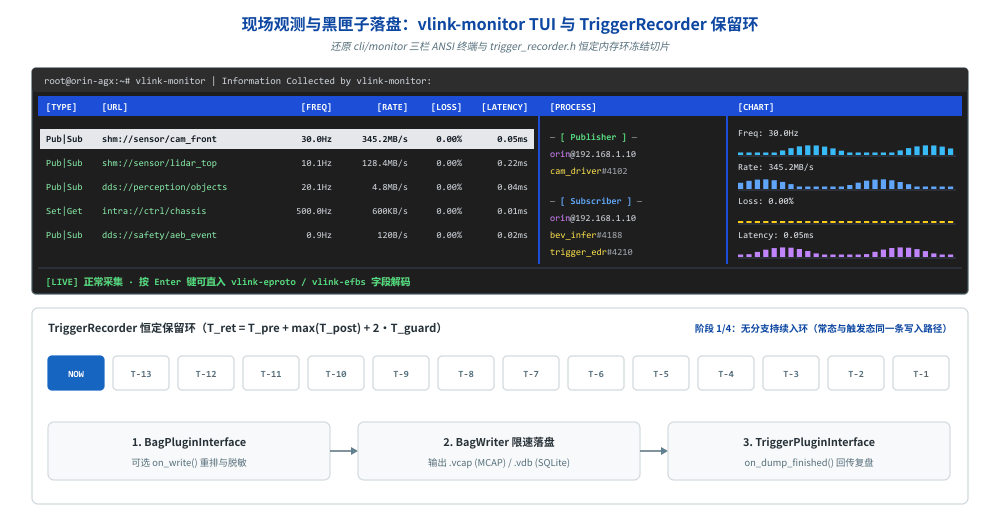

> **图 10**：上方还原车机 SSH 终端中的 `vlink-monitor` 三栏界面；下方演示突发急刹触发事件时 `TriggerRecorder` 冻结滑窗、切片落盘并交由插件回传的完整链路。

其核心巧思在于将每个话题的实时保留时长固定为常量 $T_{\text{ret}} = T_{\text{pre}} + \max(T_{\text{post}}) + 2 \cdot T_{\text{guard}}$：常态与触发态共用同一条无条件分支的写入路径，满容时默认淘汰本话题最老帧（亦支持配置丢新帧策略），避免高带宽相机流冲垮控制指令历史。触发发生后将目标环标记为 `frozen = true`（传感器下一秒掉线也不丢已缓存帧），收齐后窗后用 `std::lower_bound` 切出 `shared_ptr` 快照并按 `sleep_interval_mb` 限速落盘。落盘按后缀自动切换双引擎：`.vdb`（SQLite WAL 断电安全 + 自适应 LZAV 压缩）与 `.vcap`（Foxglove MCAP + Zstd + 可选 Chunk CRC），独立 Bag 基准下无压 MCAP 写入约 **1,448 MB/s**、读取达 **8,541 MB/s（ROS 2 `rosbag2` 5,278 MB/s 的 1.62 倍）**，SQLite WAL 写入 **905 vs 417 MB/s（2.17 倍）**。挂接 `BagPluginInterface` 与 `TriggerPluginInterface`（在 `on_frame` / `on_dump_finished` 回调中脱敏与加密上云），即可组成轻量级量产影子模式闭环。

---

## 四、v3.0.0 重磅新增：`vlink-launcher` 整机编排（对比 `ros2 launch`）

通信延迟压至微秒级之后，量产落地紧接着撞上整机编排墙：几十个进程和算法模块如何按依赖有序拉起、如何防止调试脚本 OOM 拖死规控核心、如何在行车与泊车之间无感热切模式而不断掉底盘桥接、如何避免子进程退出遗留僵尸孙进程？`ros2 launch` 本质仍是 Python 拉起脚本，缺少静态跨进程通信告警、内置组件暖备热切以及非 root cgroup v2 资源硬隔离。

**VLink v3.0.0** 新增全自研声明式编排引擎 **`vlink-launcher`**（含 `LauncherServer`、`LauncherAPI` 与 `vlink-launcher` 命令行/TUI 工具，完整手册见 `doc/11-launcher.md`），用一份静态可校验的 TOML 统一管理五类托管载体：外部可执行文件（`[[process]]`）、同进程零拷贝组件（`[[component]]`）、故障隔离插件容器（`[[container]]`）、一次性/周期任务（`[[task]]`）与代理边车（`[proxy]`）。既有外部进程与 `RunablePluginInterface` 插件零改动即可纳入，新组件仅需包含零第三方依赖单头文件 `<vlink/external/launcher_component.h>` 并链接 `vlink::vlink`。

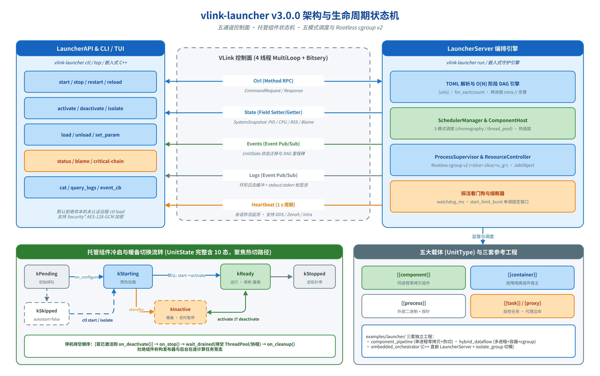

> **图 11**：`vlink-launcher` v3.0.0 五通道控制面、`LauncherServer` 编排核心、托管组件生命周期流转与停机排空不变式，以及五类载体与三套独立参考工程（源文件：[08-launcher-orchestration-and-governance.drawio](assets/diagrams/08-launcher-orchestration-and-governance.drawio)）。

相比传统脚本与 `ros2 launch`，`vlink-launcher` 在五个关键工程点上实现了量产级闭环：
- **解析期静态查错与 $O(N)$ 阶段屏障**：TOML 中的 `[urls]` 拓扑集中定义、`for_each` / `count` 模板展开以及虚拟 `stage` 阶段屏障（避免平方级边膨胀）均在解析期完成；运行 `vlink-launcher validate --check_programs` 与 `graph --format ascii`，循环依赖与缺失程序直接报错拦截，跨 OS 进程误用 `intra://` 通信链路也会输出静态告警（`rep.warnings`）。
- **冷启按需跳过与毫秒级暖备热切**：`UnitState` 完整定义 10 个运行态。对于自动泊车等非全时模块配置 `autostart = false`，冷启动跳过停在 `kSkipped` 不占内存，切模时一条 `vlink-launcher ctl isolate @parking`（或 C++ 调 `LauncherAPI::isolate_group()`）瞬间拉起泊车组并自动保留被 `requires` 依赖的底盘桥接不断流；对于冗余备用控制器配置 `autostart_state = "inactive"`，上电即完成 `on_configure()` 与显存预热并停在 `kInactive`，切主备时直接 `activate` 毫秒级接管。
- **强制停机排空不变式**：针对异步计算组件停机时发布器被提前析构导致的野指针崩溃，`ComponentHost` 将停机路径焊死为 `[若已激活先 on_deactivate()] → on_stop() → wait_drained(排空 ThreadPool 与协程) → on_cleanup()`，确保所有在途任务全部退出后才释放通信资源。
- **非 root 分代 cgroup v2 与跨平台进程树回收**：Linux 仅需宿主 `systemd` 配置 `Delegate=yes`，即可在无 root 权限下按启动代次建立独立叶子 `<root>/<slice>.slice/<unit>_g<gen>` 施加 CPU、内存与 PID 硬限额（非委托环境回退 `/proc` 后代进程树，Windows 采用分代 `JobObject`），彻底杜绝僵尸孙进程与内存泄漏跨单元蔓延。
- **隔离控制面与安全熔断**：五通道控制面（`Ctrl / State / Events / Logs / Heartbeat`）运行在独立 4 线程 `MultiLoop` 上绝不阻塞主编排循环，默认拒绝非本机未认证远程 `ctl load`，并配备 `watchdog_ms` 探活与 `start_limit_burst` 单调固定窗口熔断防重启风暴。仓库 `examples/launcher/` 提供 `component_pipeline`、`hybrid_dataflow`、`embedded_orchestrator` 三套独立可编译参考工程，拿来即可二次开发。

---

## 五、全栈工具链、双模 3D 可视化与多语言扩展生态

中间件在工程团队能否真正落地，一半取决于通信性能，另一半取决于半夜两点仅凭 SSH 连上车机时，能否在 30 秒内定界“没发包、URL 错配、掉频还是字段值异常”。VLink 从底层协议起将可观测性内建为一等公民，形成超越 RViz2 单一桌面模式的终端、桌面与 Web 全栈观测体系。

### 5.1 UDP 轻发现、四层 `bridge=1` 防回环代理与 10 个 CLI 工具

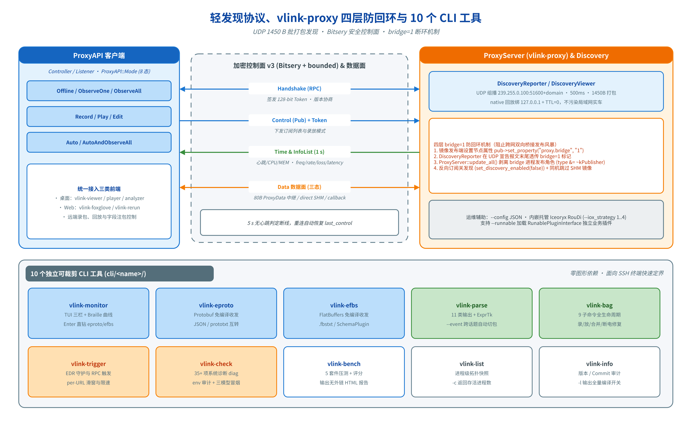

> **图 12**：UDP 1450 B 批打包轻发现、`ProxyServer` v3 控制/数据面与四层 `bridge=1` 防回环，以及 10 个零图形依赖 CLI 工具（源文件：[09-discovery-proxy-and-cli-toolchain.drawio](assets/diagrams/09-discovery-proxy-and-cli-toolchain.drawio)）。

每个 VLink 节点内置 `DiscoveryReporter`，经 UDP 组播 `239.255.0.100:51600+domain` 按 500 ms 周期批打包上报端点与 CPU 采样，2 秒失联自动摘除；本地 `native` 回放严格绑定 `127.0.0.1` 且 `TTL=0`，杜绝回放流污染同局域网实车。

跨网段观测与双域桥接由 **`vlink-proxy`（`ProxyServer`）** 承担，客户端 `ProxyAPI::Mode` 覆盖完整 8 态（`Offline`、`ObserveOne`、`ObserveAll`、`Record`、`Play`、`Edit`、`Auto`、`AutoAndObserveAll`）。控制面走加密 Bitsery 通道与 128-bit 会话 Token（5 秒无心跳判定断线，重连自动恢复 `last_control`）；数据面按部署场景在 `ProxyData`（固定结构 80 B 另附头尾与变长载荷）中继、本机直连 SHM 与进程内回调之间切换。针对双代理跨网双向桥接极易引发的发布风暴，VLink 从协议层焊死四道防线：镜像发布端打上 `proxy.bridge="1"` 属性，`DiscoveryReporter` 在端点记录中写入可选标记 `bridge=1`（其后可附 `native=1`），`ProxyServer::update_all()` 汇总快照时对带标记进程记录清除 `kPublisher` 位保留其余角色，同时反向订阅关闭自身发现并在同机跳过 SHM 镜像。

终端侧按 Unix 哲学拆出 **10 个独立可裁剪 CLI 工具**：零图形界面下敲 `vlink-monitor -x --dot`，右侧用 Braille 盲文双倍密度点阵绘制四路实时曲线，盯上异常话题**按回车直接拉起 `vlink-eproto` 或 `vlink-efbs` 免编译动态解码实时字段**；`vlink-parse` 支持 **11 类输出**与内嵌 ExprTk 表达式，配合 `--event` 一条命令即可从几十 GB 录包中按跨话题条件自动切包；上车前执行 `vlink-check diag`，一次性跨五平台体检网卡 MTU、组播路由、内核缓冲、`/dev/shm` 与守护进程等 35+ 项环境指标；配合 `vlink-bag`（9 子命令断电修复与格式互转）、`vlink-bench`、`vlink-trigger`、`vlink-list` 与 `vlink-info`，覆盖车机终端全生命周期排障。

### 5.2 桌面 Qt 三件套与 WebViz 同源双引擎（对比 RViz2）

桌面与远程可视化均通过 `ProxyAPI` 旁路接入，前端崩溃绝不影响实车总线：

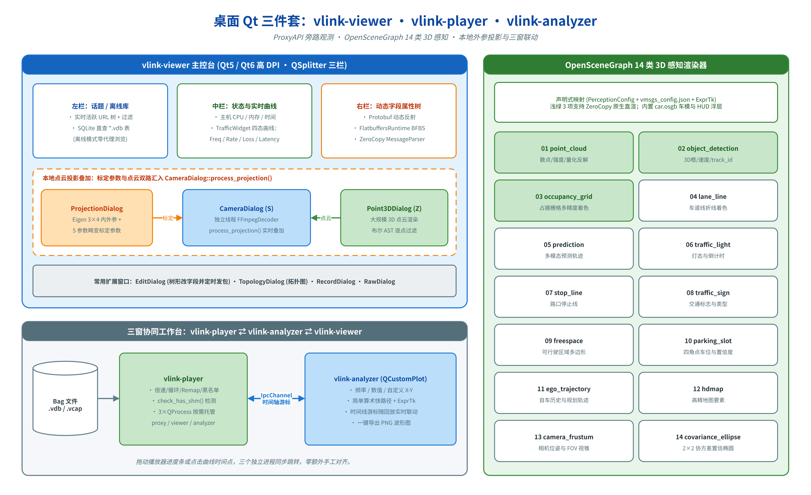

> **图 13**：桌面 Qt 三件套布局、FFmpeg 解码与 Eigen 本地外参投影、14 类 OpenSceneGraph 3D 感知渲染器及三窗 `IpcChannel` 联动（源文件：[10-desktop-qt-viewer-3d-perception.drawio](assets/diagrams/10-desktop-qt-viewer-3d-perception.drawio)）。

- **桌面 Qt 三件套（`viz/viewer/`，兼容 Qt5 / Qt6）**：面向外场重度本地调试与标定验证。`vlink-viewer` 基于 OpenSceneGraph 原生实现 **14 类自动驾驶 3D 感知渲染器**（`PointCloud`、`ObjectArray`、`OccupancyGrid` 免配置零拷贝直渲，其余通过 `vmsgs_config.json` 与 ExprTk 映射），支持树形改字段定时注包回总线；标定外参时，`ProjectionDialog` 提供 Eigen 3×4 内外参与 5 参数畸变、`Point3DDialog` 提供点云数据，双路直接汇入 `CameraDialog::process_projection()`（独立线程 FFmpeg 软硬解）在本地实时投影叠画，不向总线回发任何冗余包。搭配 `vlink-player`（自动检测 `shm://` 按需托管 proxy / viewer / analyzer）与 `vlink-analyzer`（简单算术快路径 + ExprTk），三个独立进程经 `IpcChannel` 双向绑定时间轴游标，拖动一处、三窗齐动。

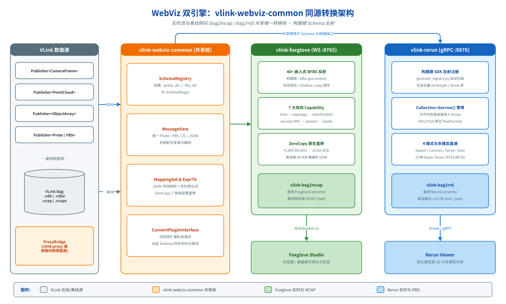

> **图 14**：`vlink-webviz-common` 共享转换核驱动 `vlink-foxglove` / `vlink-bag2mcap` 与 `vlink-rerun` / `vlink-bag2rrd` 的同源架构（源文件：[11-webviz-foxglove-and-rerun.drawio](assets/diagrams/11-webviz-foxglove-and-rerun.drawio)）。

- **WebViz 同源双引擎（`viz/webviz/`）**：将 Schema 注册、消息解码与映射规则全部收归 **`vlink-webviz-common`**，同一消息多映射只解一次码，实时桥接与离线转码工具（`vlink-bag2mcap` / `vlink-bag2rrd`）跑的是 100% 同一份转换核，彻底杜绝实时与离线口径漂移。**`vlink-foxglove`（WS `:8765`）** 在构建期嵌入全套官方 Foxglove BFBS Schema，原生 Proto/FBS 走 `shallow_copy` 透传，完整支持 7 项双向能力与单连接 64 MiB 慢端防 OOM；**`vlink-rerun`（gRPC `:9876`）** 在构建期通过 `generate_registry.py` 自动扫描 `rerun_sdk` 头文件生成全量 Arrow 注册表，对齐内存经 `rr::Collection<T>::borrow()` 零拷贝移交，NV12 / YUV 直接走原生 `PixelFormat`。

### 5.3 Python 零拷贝绑定、纯 C ABI、9 类动态插件与五平台极简交付

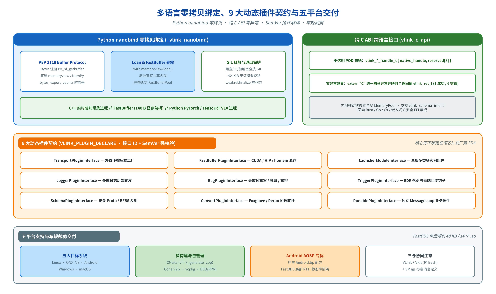

> **图 15**：Python `nanobind` 零拷贝绑定、纯 C ABI、9 类动态插件契约与五平台交付矩阵（源文件：[12-bindings-plugins-and-delivery.drawio](assets/diagrams/12-bindings-plugins-and-delivery.drawio)）。

针对具身智能中 C++ 实时控制与 Python VLA 推理协同的刚需，VLink Python 绑定基于 **nanobind** 重写：`Bytes` 完整接入 PEP 3118 Buffer Protocol，零拷贝直通 `memoryview`、NumPy 与 PyTorch，并用 `bytes_export_counts` 引用计数锁住底层内存防悬垂；Python 侧同样可直接调用传输层 `loan()`（`with memoryview(loan):` 原地写共享内存）与 `FastBufferPool`，配合全路径释放 GIL、超 64 KiB 无订阅者短路及 `weakref.finalize` 退出防护，彻底摆脱 `rclpy` 的序列化拷贝瓶颈。纯 C ABI `vlink_c_api` 以不透明 POD 句柄和 `vlink_ret_t` 共 **7 个返回值（1 个成功、6 个错误）** 将 C++ 异常完全隔离在边界之内，供 Rust、Go、C# 与嵌入式 C 安全接入。

全栈从传输后端、GPU / DMA-BUF 显存、Launcher 模块到日志、录包、WebViz 转换共 **9 类扩展点**均采用带接口 ID 与 SemVer 校验的动态插件契约。平台交付覆盖 **Linux、QNX 7/8、Android、Windows、macOS**，提供 CMake（`vlink_generate_cpp()`）、Conan 2.x、vcpkg、DEB/RPM 及 Android AOSP 原生 `Android.bp`（将 Fast-DDS 类型注册拆成局部 RTTI 静态库，避免整仓被迫开启 RTTI）。配合纯 Bash 零 Python 依赖构建套件 **VKit** 与标准消息库 **VMsgs**，单链一个 Fast-DDS 后端的示例程序最终仅 **48.0 KB**、依赖 **14 个 `.so`（闭合库文件合计 21.95 MB）**，相较 ROS 2（993.1 KB、102 个 `.so`、闭合 29.17 MB）体量大幅收敛。

---

## 六、6/6 物理同库实测对比：硬数据与坦诚边界

为了杜绝“拿新库打老库”的不公平对比，2026 年 11 月在 AMD Ryzen 7 5800X + Linux 6.12 + GCC 16.2 上执行的 **VLink vs ROS 2 Humble** 全量评测（原始报告归档于 `.github/perf/vlink_vs_ros2_report.html`，采自 `v2.4.0 @ 9d880ba`，3 轮中位数，总耗时 874.6 秒）在开跑前通过 `ldd` 强制审计：双方加载的 `libfastrtps.so.2.6.10`、`libfastcdr.so.1.0.24`、`libddsc.so.0.10.5`、`libiceoryx_posh.so` (2.0.5)、`libzstd.so.1.5.7`、`libsqlite3.so.3.53.4` 全部指向磁盘上**物理完全相同的 6 个动态库文件**。在此前提下，七维同库量化评分 **VLink 84.0 vs ROS 2 Humble 66.6**（含定性维度的综合评分 **84.6 vs 72.0**）。

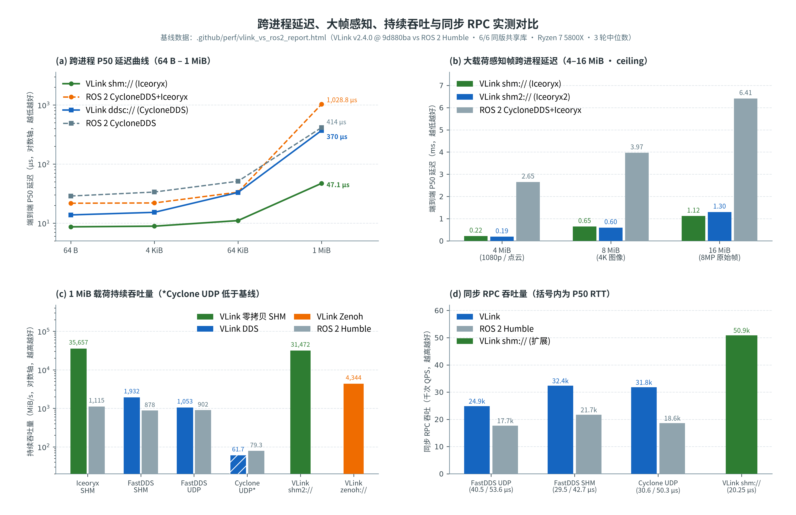

> **图 16**：6/6 物理同库跨进程通信实测。(a) 64 B – 1 MiB 定频 P50 延迟曲线；(b) 4 – 16 MiB 大载荷帧延迟（上限参照）；(c) 1 MiB 饱和吞吐量（含 CycloneDDS UDP 斜线落后柱）；(d) 同步 RPC 吞吐与 P50 RTT。

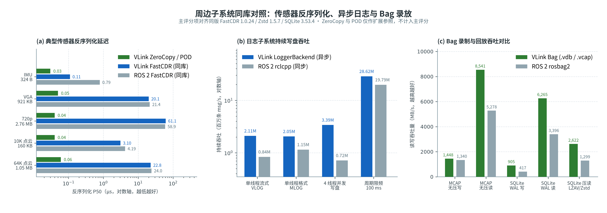

> **图 17**：周边引擎同库对照。(a) 传感器反序列化（区分同库 FastCDR 蓝柱与扩展零拷贝绿柱）；(b) 异步日志 vs `rclcpp` 写盘吞吐；(c) 同库 Zstd / SQLite 下的 Bag 录放吞吐。

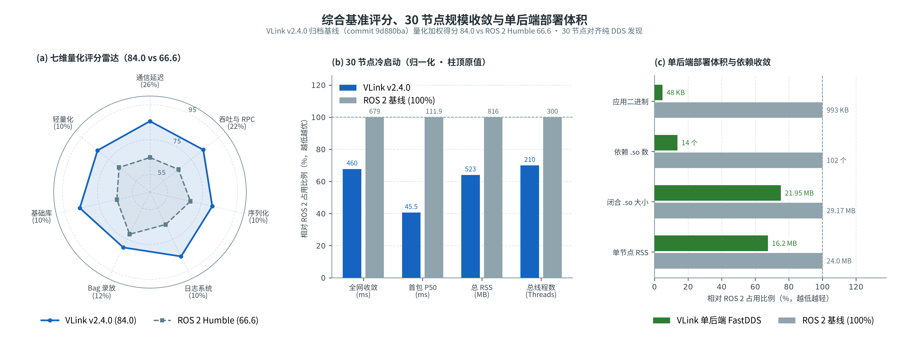

> **图 18**：(a) 七维量化雷达图（VLink 84.0 vs ROS 2 Humble 66.6）；(b) 30 节点 FastDDS UDP 并发冷启动与资源开销；(c) 单后端示例部署体量相对 ROS 2 归一化对照。

| 实测项目（6/6 物理相同 `.so` 对齐） | VLink（`v2.4.0 @ 9d880ba`） | ROS 2 Humble | 实测优势 |
| :--- | :---: | :---: | :--- |
| FastDDS UDP 64 B / CycloneDDS UDP 64 B（P50） | **19.1 µs / 13.8 µs** | 28.3 µs / 28.7 µs | 延迟降低 **32.5%** / 快 **2.09 倍** |
| FastDDS SHM 1 MiB（P50 / P99） | **177.3 µs / 255.4 µs** | 247.9 µs / 9,019.0 µs | P99 尾延迟收敛 **35.3 倍** |
| Iceoryx SHM 1 MiB（定频 P50 / 饱和吞吐） | **47.1 µs / 35,657 MiB/s** | 1,028.8 µs / 1,115 MiB/s（Cyc+Iox） | 延迟快 **21.8 倍**，有效载荷吞吐高 **32.0 倍** |
| Iceoryx SHM 4 / 8 / 16 MiB 大帧（P50） | **0.22 / 0.65 / 1.12 ms** | 2.65 / 3.97 / 6.41 ms（Cyc+Iox） | 4 MiB 快 **12.1 倍**，16 MiB 快 **5.7 倍** |
| 同步 RPC（FastDDS SHM QPS / P50 RTT） | **32,356 QPS / 29.5 µs** | 21,694 QPS / 42.7 µs | 高 **1.49 倍**（`shm://` 上限参照 50,876 QPS / 20.25 µs） |
| 同库同线格式 FastCDR（324 B IMU / 10K 点云） | **0.11 µs / 3.10 µs** | 0.79 µs / 4.19 µs | 快 **7.2 倍** / **1.35 倍**（720p 同走 CDR 基本持平：61.1 vs 58.9 µs） |
| 扩展零拷贝参照（720p / 64K 点云，不计入 84.0 主分） | **0.04 µs / 0.06 µs** | 58.92 µs / 23.96 µs (CDR) | 指针借用免整帧反序列化 |
| 日志持续写盘（单线程流式 / 4 线程并发） | **2.11M / 3.39M msg/s** | 0.84M / 0.72M msg/s | 高 **2.5 倍** / **4.7 倍** |
| Bag 录放（无压 MCAP 读 / SQLite WAL 写） | **8,541 / 905 MB/s** | 5,278 / 417 MB/s | 高 **1.62 倍** / **2.17 倍** |
| 30 节点 FastDDS UDP 并发冷启动（关额外 UDP 发现） | **460 ms，523 MB，210 线程** | 679 ms，816 MB，300 线程 | 收敛快 **32%**，首包快 **2.46 倍**（45.5 vs 111.9 ms），省 **293 MB**、少 **90 线程** |
| 单后端 FastDDS 示例体量与动态库 | **48.0 KB，14 个 `.so`（21.95 MB）** | 993.1 KB，102 个 `.so`（29.17 MB） | 可执行文件小 **20.7 倍**，动态库少 **7.3 倍** |

物理共享库完全一致的情况下，差距来自四笔明确的架构账：第一，VLink 接收线程沿编译期展开路径直达回调，省去了 `rclcpp → rcl → rmw → Executor` 四层跳数；第二，传输层 RAII Loan 与冻结容器清除了共享内存上层的中间对象拷贝；第三，19 档分片内存池与锁外回收稳住了大载荷高频收发的 P99 抖动；第四，单节点不携带默认参数服务与上百个辅助动态库，显著压低了多进程冷启动收敛时间与常驻内存。

### 公开透明的落后项、测试前提与选型边界
- **3 组纯 UDP 饱和吞吐低于 ROS 2**：FastDDS UDP 1 KiB 为 `23.8 vs 43.6 MiB/s`，CycloneDDS UDP 1 KiB 为 `129.3 vs 137.8 MiB/s`，CycloneDDS UDP 1 MiB 为 `61.7 vs 79.3 MiB/s`，属于后续 UDP 批量写调度优化重点。
- **可复现前提对齐**：VLink 为兼顾跨机兼容默认关闭 FastDDS 内置 SHM（1 MiB P50 延迟默认慢约 1.20×：`314.0 vs 261.7 µs`），同机对比设 `VLINK_DDS_SHM=1` 对齐后 P50 延迟快约 **1.40×**（`177.3 vs 247.9 µs`）、饱和吞吐高约 **2.20×**（`1,931.8 vs 878.5 MiB/s`）；30 节点 210 线程在设置 `VLINK_DISCOVERY_DISABLE=1` 对齐纯 DDS 发现后测得（开启额外 UDP 发现每节点增 1 线程 2 FD）；对标基线为 ROS 2 Humble，升级 Jazzy+ 并启用 `EventsExecutor` 后 ROS 2 调度差距会缩小。
- **跨线格式与压缩取舍**：720p 0.04 µs 零拷贝已从 84.0 同库主分严格剔除；`intra://#direct`（50 ns）为发布线程同步调用，异步 `#queue` 64 B 小包因 `futex_wait` 唤醒（5.36 µs）高于 ROS 2 轮询（2.40 µs），但吞吐高 7.8 倍且大包反超；SQLite 压缩回放 VLink 单核 LZAV 速度高 2 倍（2,622 vs 1,299 MB/s），ROS 2 双线程 Zstd 压缩比更高（1.62 vs 1.30）。
- **选型建议**：科研原型、机械臂开发及重度依赖 MoveIt2 / Nav2 / TF2 现成驱动栈的团队应继续使用 ROS 2；面向**量产自动驾驶域控、高频人形机器人本体、大帧与显存零拷贝、多协议融合、国产自主可控、QNX / Android 轻量化体量、委托环境非 root 整机编排以及车端黑匣子与 3D 调试**的团队，VLink v3.0.0 具备显著的工程适配优势，并可通过原生 XCDR 与 MCAP 与既有 ROS 2 仿真系统平滑共存。

---

## 七、真实项目选型参考与四步渐进迁移路径

将 VLink v3.0.0 投入自动驾驶域控或人形机器人整机软件栈时，各类典型业务链路可直接按如下配置落地：

| 业务链路 | 典型频率与载荷 | 推荐配置（URL 与核心能力） | 选型理由 |
| :--- | :--- | :--- | :--- |
| **多路 8MP 相机 → BEV / VLA** | 30 Hz × 12 MB | `shm://cam/front` + `FastBuffer` (CUDA / HIP / `hbmem`) | 显存留在设备内不动，同机共享句柄仅传 140 B；312 B 控制块防下游崩死采集 |
| **128 线 LiDAR → 感知融合** | 10–20 Hz × 4 MB | `shm://lidar/top` + `PointCloud`（两层零拷贝） | 0.22 ms 送达、0.06 µs 反序列化，内置 16-bit 量化与体素降采样 |
| **人形全身动力学伺服回路** | 500–2,000 Hz × 256 B | `intra://ctrl/wbc#direct` 或 `shm2://ctrl/wbc` | 50 ns 同进程直达，或无 RouDi 守护 Rust 共享内存进程隔离 |
| **跨算力板协同 / ROS 2 互通** | 20–100 Hz × 64 KB | `dds://plan/traj?qos=best` + 原生 XCDR | 免独立桥接直连 ROS 2 节点，配 `dds.noblock` 防网络拥塞反卡控制线程 |
| **底盘执行 ECU 服务调用** | 50–100 Hz × 64 B | `someip://1001/1?method=1` + ARXML 生成器 | 严守 AUTOSAR R25-11 线格式，自动生成带超限校验的 C++17 头文件 |
| **座舱 3D SR / 远程看车** | 10–30 Hz | `fdbus://` 或 `ProxyServer` + Qt / Foxglove / Rerun | 四层 `bridge=1` 防回环；本地 14 类 OSG 3D 与远程双 Web 同源转换 |
| **云边遥操作 / 异常黑匣子** | 广域网 / 事件触发 | `zenoh://` + `Security v2` + `TriggerRecorder` | TLS 与 34 B 固定头 AEAD 叠加，可配置进程内内存环抓回急刹与接管现场 |
| **整机进程编排 / 行泊切模** | 整机 DAG 与 cgroup | `vlink-launcher`（TOML + `choreography` + `[[container]]`） | Linux `Delegate=yes` 委托 cgroup v2 限额，`ctl isolate @parking` 热切不断底盘桥接 |

既有项目无需停产重写，按四步即可平滑迁移：
1. **单测与 CI 跑顺契约**：用 `intra://` 在单进程测试与 CI 中跑通新模块接口，摆脱对外部守护进程的依赖；
2. **同机吃满零拷贝红利**：通过 `VLINK_URL_REMAP` 将同机节点切至 `shm://` / `shm2://`，并对大载荷相机与张量链路接入 `FastBuffer` 显存共享；
3. **跨板与 ROS 2 无缝互通**：跨算力板切至 `dds://` / `ddsc://`，借原生 XCDR 保留既有 ROS 2 仿真与算法节点；
4. **整机编排与车规裁剪交付**：量产前交由 `vlink-launcher` 统一管理依赖与 cgroup v2 资源隔离，按需启用 `someip://` / `fdbus://` / `zenoh://`、`Security v2` 与 `TriggerRecorder`，经 CMake / Conan 裁剪至单后端示例 48 KB、14 个动态库的精简交付形态。

VLink 以商业友好的 **Apache 2.0** 协议完整开源。欢迎直接拉取仓库运行 `vlink-bench` 与 `examples/launcher/` 中的三套独立参考工程，用真机数据检验每一项架构收益。

---

### 参考与延伸阅读

- 项目主页与开源仓库：<https://vlink.work> ｜ <https://github.com/thun-res/vlink>
- 完整中文架构手册：仓库 `doc/` 目录（含 `doc/04-transport.md`、`doc/06-zerocopy.md`、`doc/11-launcher.md`、`doc/12-visualization.md`）
- 6/6 同库实测原始归档：仓库 `.github/perf/vlink_vs_ros2_report.html`
- Launcher 三套独立示例：仓库 `examples/launcher/`（`component_pipeline` / `hybrid_dataflow` / `embedded_orchestrator`）
- 相关标准与文献：OMG DDS 1.4 & DDS-Security 1.1 · AUTOSAR Foundation R25-11 · Eclipse Iceoryx / Iceoryx2 / Zenoh · eProsima Fast-DDS / Fast-CDR · Foxglove MCAP Specification · Macenski et al., *Robot Operating System 2*, Science Robotics (2022)
