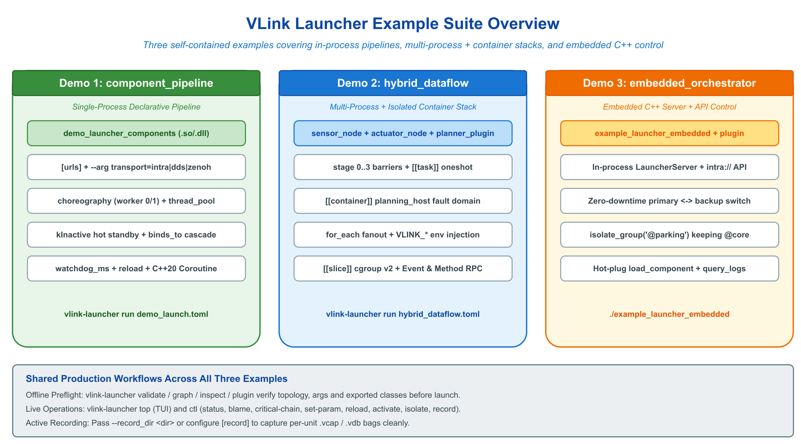

# VLink Launcher 示例集

本目录收录 **4 个独立可构建、定位分明且功能完整的 VLink Launcher 示例工程**，分别覆盖 **进程内组件流水线**、**多进程 + 隔离容器 + 资源治理混合栈**、**C++ 嵌入式编程式编排器与模式热切** 以及 **多层级 TOML 嵌套编排（`[[include]]` + 嵌套参数表）** 四类典型生产形态。



> 架构图源文件：[images/launcher-examples-overview.drawio](images/launcher-examples-overview.drawio)

---

## 目录导航与特性全景对比

四个子工程既可随总仓一键编译，也可进入任意子目录单独配置构建（其中 `nested_includes` 复用 `component_pipeline` 构建产出的 `demo_launcher_components` 插件，独立运行时需先构建该插件并放到 `plugin_dirs` 目录）：

| 示例工程 | 编排范式 | 构建产物 | 核心覆盖特性 | 典型适用场景 |
| --- | --- | --- | --- | --- |
| [component_pipeline](component_pipeline/README.md) | CLI 声明式单进程编排 | `demo_launcher_components`<br>`demo_launch.toml` | `[urls]` 集中拓扑、`[args]` 传输切换（`intra`/`dds`/`zenoh`）、`choreography` 固定槽位 + `lockfree` `ThreadPool` 卸载、`LauncherTimerComponent` / `LauncherComponent` / C++20 `LauncherCoroutineComponent`、`kInactive` 主备热切、`binds_to` 联停、`watchdog_ms`、`reload`、`vlink-launcher top / ctl` | 车端/机器人单进程极致低延迟感知-融合-控制流水线 |
| [hybrid_dataflow](hybrid_dataflow/README.md) | 多进程 + 隔离容器混合编排 | `example_launcher_sensor_node`<br>`example_launcher_actuator_node`<br>`example_launcher_planner_plugin`<br>`hybrid_dataflow.toml` | `[[task]]` `oneshot` 自检、`[[process]]` 外部进程、`[[container]]` 故障隔离宿主、`[[slice]]` cgroup v2（CPU/内存限额）、`stage = 0..3` 分层屏障、`for_each` 模板扇出、`VLINK_*` 环境变量自动注入、`stdout` 就绪探针、`start_limit_burst` 熔断、Event + Method RPC 混合通信、`choices` 参数校验与跨进程 `intra://` 静态告警 | 既有外部独立进程又有高频算法插件的异构生产栈 |
| [embedded_orchestrator](embedded_orchestrator/README.md) | C++ 嵌入式编程管控（全自包含） | `example_launcher_embedded`<br>`example_launcher_embedded_components`<br>`embedded_orchestrator.toml` | 宿主直嵌 `vlink::LauncherServer` + `intra://` `vlink::LauncherAPI`、`validate` / `export_graph` / `inspect_plugin`、`register_event_callback`、`get_unit_config`、`set_param` / `reload_unit`、`activate_unit` / `deactivate_unit` 主备切换、**`isolate_group("@parking")` 受控模式切换**、`load_component` / `unload_component` 动态热插拔与端口绑定（`inputs`）、`LauncherPublisher` / `LauncherSubscriber` 生命周期受管端口、`query_logs` + 启动 Blame 统计 | 将 Launcher 作为状态机或任务调度内核嵌入上层 C++ 主控程序 |
| [nested_includes](nested_includes/README.md) | 多层级 TOML 嵌套编排 | `nested_includes/system_root.toml`<br>`nested_includes/subsystems/*.toml`<br>`nested_includes/subsystems/sensors/camera_unit.toml` | 3 层递归 `[[include]]`、`namespace` 逐级叠加、`for_each` 模板子清单批量实例化、`condition` 条件子系统裁剪、`[include.args]` 向下传参（含浮点/字符串/整数）、跨子树绝对依赖（`/fleet/...`）、多层嵌套 `[params.*]` 子表自动展平 | 大型机器人/车载系统按子系统拆分、模块化复用编排清单 |

---

## 构建说明

### 1. 随 VLink 主仓库一并构建（推荐）

启用 `ENABLE_LAUNCHER=ON` 与 `ENABLE_EXAMPLES_ALL=ON`（`ENABLE_EXAMPLES_ALL=ON` 已包含示例总入口）：

```bash
cmake -B build -DCMAKE_BUILD_TYPE=Release \
  -DENABLE_LAUNCHER=ON \
  -DENABLE_EXAMPLES_ALL=ON
cmake --build build -j
```

构建完成后，全部可执行文件、插件动态库与对应 `.toml` 清单均会自动汇集至 `build/output/bin/`：

```text
build/output/bin/
├── vlink-launcher                                 # CLI / TUI / ctl 统一入口
├── libdemo_launcher_components.so                 # Demo 1 插件库
├── demo_launch.toml                               # Demo 1 编排清单
├── example_launcher_sensor_node                   # Demo 2 外部传感器进程
├── example_launcher_actuator_node                 # Demo 2 外部执行器进程
├── libexample_launcher_planner_plugin.so          # Demo 2 隔离容器插件库
├── hybrid_dataflow.toml                           # Demo 2 编排清单
├── example_launcher_embedded                      # Demo 3 嵌入式宿主程序
├── libexample_launcher_embedded_components.so     # Demo 3 自包含插件库
├── embedded_orchestrator.toml                     # Demo 3 编排清单
└── nested_includes/                               # Demo 4 多层级递归 [[include]] 编排清单
```

> Windows 平台插件后缀为 `.dll`，macOS 为 `.dylib`；CMake 已自动同步多配置输出目录并将 `.toml` 复制至产物同级目录。

### 2. 单独构建某个子工程

在已安装 VLink（配置了 `CMAKE_PREFIX_PATH` 或 `vlink_DIR`，且已将 `vlink-launcher` 所在 `bin/` 加入 `PATH`）的环境中，可进入任意子目录独立配置：

```bash
cd examples/launcher/component_pipeline   # 或 hybrid_dataflow / embedded_orchestrator
cmake -B build -DCMAKE_BUILD_TYPE=Release
cmake --build build -j
```

独立构建的 Demo 1 / Demo 2 使用已安装的 `vlink-launcher` 运行对应目录中的 `.toml` 清单。

---

## 快速上手（4 套 Demo 运行直达）

以下命令均假设当前位于 `build/output/bin` 目录：

### Demo 1：进程内组件流水线

```bash
# 1. 静态预检、导出依赖图与检查插件导出类
./vlink-launcher validate demo_launch.toml
./vlink-launcher graph demo_launch.toml --format ascii
./vlink-launcher plugin libdemo_launcher_components.so

# 2. 启动流水线（默认 intra:// 同进程低开销通道，可按需切为 dds 或 zenoh；支持 --record_dir 主动录制）
./vlink-launcher run demo_launch.toml --arg transport=intra --arg period_ms=250

# 3. 另开终端体验实时 TUI 与热运维
./vlink-launcher top
./vlink-launcher ctl set-param -u sensor sensor_id=lidar_rt
./vlink-launcher ctl reload sensor
./vlink-launcher ctl activate controller_backup && ./vlink-launcher ctl deactivate controller
```

详见 [component_pipeline/README.md](component_pipeline/README.md)。

### Demo 2：多进程 + 隔离容器 + 资源治理混合栈

```bash
# 1. 静态检查可执行程序路径、模板展开与依赖图
./vlink-launcher validate hybrid_dataflow.toml --check_programs
./vlink-launcher graph hybrid_dataflow.toml --format ascii

# 2. 验证 [args.transport].choices 枚举校验拒绝跨进程 intra://（预期报错退出）
./vlink-launcher validate hybrid_dataflow.toml --arg transport=intra

# 3. 启动完整 4 阶段混合栈（可扩展为 3 路传感器扇出）
./vlink-launcher run hybrid_dataflow.toml --arg transport=dds --arg sensors=front,rear

# 4. 另开终端查看启动耗时、依赖树与安全监控健康状态
./vlink-launcher ctl --namespace hybrid_launcher blame
./vlink-launcher ctl --namespace hybrid_launcher status safety_supervisor
```

详见 [hybrid_dataflow/README.md](hybrid_dataflow/README.md)。

### Demo 3：C++ 嵌入式编程式编排与模式隔离

```bash
# 零外部配置依赖，直接运行即可完整演练 6 步运行期管控并自动优雅退场
./example_launcher_embedded
```

程序会自动依次完成：插件自检 → 清单校验与拓扑图输出 → 事件订阅冷启动 → 配置查看/在线调参/热重载 → 主备零中断切换 → `isolate_group("@parking")` 模式隔离切换 → `TelemetryTap` 热插拔与 URL Remap → 环形日志查询与启动耗时 Blame 汇总 → 优雅异步停机。

详见 [embedded_orchestrator/README.md](embedded_orchestrator/README.md)。

### Demo 4：多层级 TOML 嵌套编排（`[[include]]` + 嵌套参数表）

```bash
# 1. 静态校验与导出 3 层展开后的依赖图 & 数据流拓扑
./vlink-launcher validate nested_includes/system_root.toml
./vlink-launcher graph nested_includes/system_root.toml --format ascii

# 2. 启动完整 3 层嵌套流水线（cam -> fusion -> controller -> monitor）
./vlink-launcher run nested_includes/system_root.toml --arg cameras=front,rear
```

详见 [nested_includes/README.md](nested_includes/README.md)。

---

## TOML 声明式编排核心机制速查

四套示例完整覆盖了 VLink Launcher 的核心声明式语法，可作为生产清单的编写蓝本：

### 1. `[urls]` 单一拓扑事实源与自动注入

无需在 C++ 代码里硬编码通道地址：在清单顶部 `[urls]` 集中定义通道后，各单元通过 `inputs` / `outputs` / `urls` 声明连接关系，Launcher 会自动完成：

- **组件插件**：通过 `LauncherContext::get_input_url()` / `get_output_url()` / `get_url()` 读取并叠加命名空间与 `remaps`。
- **外部进程**：自动按 `VLINK_INPUT_<KEY>`、`VLINK_OUTPUT_<KEY>`、`VLINK_URL_<KEY>`（大写规范化）注入进程环境变量。
- **静态拓扑分析**：`vlink-launcher graph` 自动渲染数据流边；`validate` 会对跨 OS 进程（如 `[[process]]` 与 `[[container]]` 之间）误用 `intra://` 的数据流边发出静态告警（配合 `[args].choices` 可在参数解析阶段直接拒绝非法协议）。

### 2. 执行单元与调度器选型

| 类型 / 键 | 说明 | 对应示例 |
| --- | --- | --- |
| `[[component]]` | 同进程托管的 `LauncherComponent` / `LauncherTimerComponent` / `LauncherCoroutineComponent` 插件实例 | Demo 1 / Demo 2 / Demo 3 |
| `[[container]]` | 独立 OS 进程托管组件插件，崩溃隔离且自动重连控制面 | Demo 2 (`planning_host`) |
| `[[process]]` | 独立外部可执行程序，支持 `stdout` / `file` / `topic` / `delay` 就绪探针与 `start_limit_burst` 熔断 | Demo 2 (`actuator`, `sensor_*`) |
| `[[task]]` | `kind = "oneshot"` 一次性启动前自检/初始化任务，退出码 0 放行后续阶段 | Demo 2 (`preflight`) |
| `[[scheduler]]` `pinned`（别名 `choreography`） | 多线程固定槽位调度（配合 `worker` 绑核/固定线程与 `priority` 优先队列） | Demo 1 / Demo 2 / Demo 3 |
| `[[scheduler]]` `pool`（别名 `thread_pool`） | `lockfree` 无锁工作线程池，供组件通过 `ctx.post_compute_task()` 卸载耗时计算 | Demo 1 / Demo 2 / Demo 3 |

### 3. systemd 风格依赖、模式隔离与资源切片

- **顺序与强弱依赖**：`stage = 0..N` 构成 $O(N)$ 分层屏障；`after` 控制先后顺序；`requires` 表示强依赖（并进入 `isolate_group` 保留闭包）；`binds_to` 实现宿主/上游停机时的级联联动停止。
- **暖备与按需启动**：`init_state = "inactive"`（兼容别名 `autostart_state`）使组件完成 `on_configure` 后停留在 `kInactive` 热备态，可通过 `activate` 亚毫秒级切入；`autostart = false` 使单元冷启动时跳过进入 `kSkipped` 零资源开销态，按需拉起。
- **模式切换（`isolate`）**：调用 `ctl isolate @group` 或 `api.isolate_group("@group")` 时，Launcher 自动计算目标组及其 `requires`/`wants` 依赖闭包，逆拓扑停止闭包外单元并正拓扑拉起目标组单元。
- **资源治理（`[[slice]]`）**：在 Linux cgroup v2 环境下自动对归属该切片的进程/容器施加 `cpu_quota_percent` 与 `memory_max_mb` 硬限额。

---

## 常用 CLI / TUI / `ctl` 运维速查

```bash
# 静态诊断与脚手架
vlink-launcher validate <file.toml> [--check_programs] [--json]
vlink-launcher graph <file.toml> --format ascii|dot|mermaid
vlink-launcher inspect <file.toml> --json
vlink-launcher plugin <lib_name_or_path>

# 启动控制与调试开关
vlink-launcher run <file.toml> --dry_run                      # 仅校验并打印启动计划
vlink-launcher run <file.toml> --show_args                    # 查看所有声明参数与默认值
vlink-launcher run <file.toml> --only @drive --skip sensor_rear
vlink-launcher run <file.toml> --parallel 2 --pause_on_fail   # 限制并发并在首次失败暂停

# 实时交互式 TUI（j/k 选中 · s 启动 · x 停止 · r 重启 · o 重载 · b 耗时排序 · l 日志 · q 退出）
vlink-launcher top [--namespace <ns>]

# 远程 / 本地运维控制面（与 LauncherAPI 一一对应）
vlink-launcher ctl status [--watch] [<unit>]
vlink-launcher ctl blame                                      # 冷启动耗时排行榜
vlink-launcher ctl critical-chain [<unit>]                    # 关键路径瓶颈定位
vlink-launcher ctl cat <unit>                                 # 查看解析后的生效配置
vlink-launcher ctl logs -u <unit|@group> -n 50 -f --grep ERR
vlink-launcher ctl start|stop|restart|reload|activate|deactivate|reset-failed <unit|@group>
vlink-launcher ctl isolate @<group>
vlink-launcher ctl load -u <name> --lib <lib> --class <cls> --scheduler <sched> --worker 0
vlink-launcher ctl unload -u <name>
vlink-launcher ctl params -u <unit>
vlink-launcher ctl set-param -u <unit> <key>=<value>
vlink-launcher ctl shutdown
```

---

## 延伸阅读

- [第 11 章：Launcher 服务编排](../../doc/11-launcher.md)：完整架构说明、TOML 字段参考与控制面协议
- [生产参考配置模板](../../src/external/launcher_api/etc/launcher_example.toml)：覆盖全部配置项的完整模板
- [Launcher 单元测试套件](../../test/launcher/launcher_test.cc)：覆盖全部边界条件与回归断言
