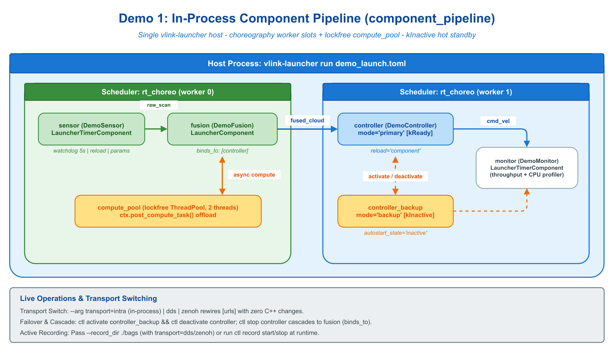

# Demo 1：进程内感知-融合-控制流水线（`component_pipeline`）

本示例通过声明式清单 [demo_launch.toml](demo_launch.toml) 与单插件动态库 [demo_components.cc](demo_components.cc)，在单个 `vlink-launcher` 宿主进程内构建一条完整的 **传感器 → 融合计算 → 主/备控制器 → 性能监控** 数据流水线，重点演示 `intra://` 同进程低开销通道编排、确定性线程槽位绑定、无锁线程池计算卸载以及 `kInactive` 热备无中断切换。



> 架构图源文件：[images/component-pipeline-flow.drawio](images/component-pipeline-flow.drawio)

---

## 组件与调度规划

| 实例名 | 导出类名 | 基类 | 调度器与槽位 | 关键特性 |
| --- | --- | --- | --- | --- |
| `sensor` | `DemoSensor` | `LauncherTimerComponent` | `rt_pinned` · `worker 0` | `watchdog_ms = 5000`、`reload = "component"`、`on_param_changed`、参数化发布频率 |
| `fusion` | `DemoFusion` | `LauncherComponent` | `rt_pinned` · `worker 0` + `compute_pool` | `ctx.post_compute_task()` 无锁线程卸载、`binds_to = ["controller"]` 级联联停 |
| `controller` | `DemoController` | `LauncherComponent` | `rt_pinned` · `worker 1` | 主控实例（`mode = "primary"`），默认启动进入 `kReady`，支持在线 `reload` |
| `controller_backup` | `DemoController` | `LauncherComponent` | `rt_pinned` · `worker 1` | `init_state = "inactive"` 暖备实例，冷启动仅执行 `on_configure()`；首次 `activate` 执行 `on_start()` + `on_activate()`，后续 `deactivate`/`activate` 免重建端点 |
| `monitor` | `DemoMonitor` | `LauncherTimerComponent` | `rt_pinned` · `worker 1` | 周期观测 `cmd_vel` 吞吐与 `ctx.get_cpu_usage()` 细粒度 CPU 占用 |
| *(可选)* | `DemoCoroMonitor` | `LauncherCoroutineComponent` | — | 当启用 C++20 协程（`VLINK_ENABLE_COROUTINE`）时一并导出，演示 `co_sleep` + `watchdog_ping` |

---

## 构建

- **整仓构建**：见上级 [examples/launcher/README.md](../README.md)。
- **独立构建**：

```bash
cmake -B build -DCMAKE_BUILD_TYPE=Release
cmake --build build -j
```

构建产物：`demo_launcher_components` 动态库与同级 `demo_launch.toml`。

---

## 运行与在线运维实验

进入产物目录（如 `build/output/bin`）后执行：

### 1. 静态校验、导出拓扑与插件自检

```bash
./vlink-launcher validate demo_launch.toml
./vlink-launcher graph demo_launch.toml --format ascii
./vlink-launcher inspect demo_launch.toml --json
./vlink-launcher plugin libdemo_launcher_components.so
```

### 2. 启动流水线（支持一键切换传输协议）

```bash
# 默认 intra:// 同进程低开销通道
./vlink-launcher run demo_launch.toml

# 通过 --arg 覆盖传输协议、周期与传感器标识（无需改动任何代码）
./vlink-launcher run demo_launch.toml --arg transport=dds --arg period_ms=100 --arg sensor_id=lidar_top
```

### 3. 在线调参、热重载与主备热切

另开终端通过 `vlink-launcher ctl` 或 `vlink-launcher top` 实时操作：

```bash
# 启动交互式 TUI 面板
./vlink-launcher top

# 查看状态与冷启动耗时 Blame
./vlink-launcher ctl status
./vlink-launcher ctl blame

# 动态修改参数并热重载 sensor（零进程重启）
./vlink-launcher ctl set-param -u sensor sensor_id=lidar_rt
./vlink-launcher ctl reload sensor

# 零中断主备热切：先激活 controller_backup，再将 controller 降级回 kInactive
./vlink-launcher ctl activate controller_backup
./vlink-launcher ctl deactivate controller

# 验证 binds_to 级联行为：停止 controller 时，绑定其上的 fusion 会自动联停
./vlink-launcher ctl stop controller
```
