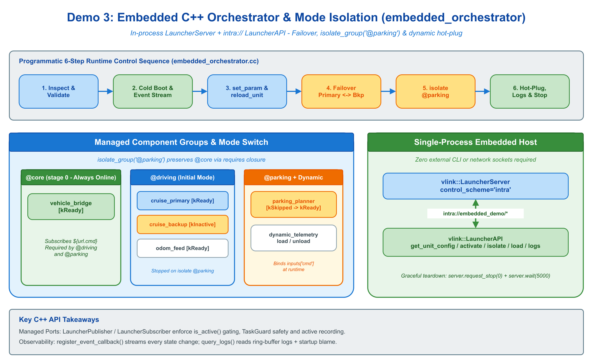

# Demo 3：C++ 嵌入式编程式编排器与模式隔离（`embedded_orchestrator`）

本示例完全自包含，由 C++ 宿主程序 [embedded_orchestrator.cc](embedded_orchestrator.cc)、专属插件库 [embedded_components.cc](embedded_components.cc) 与清单 [embedded_orchestrator.toml](embedded_orchestrator.toml) 组成。演示如何不依赖外部 CLI，直接在 C++ 业务进程内嵌入 `vlink::LauncherServer` 与基于 `intra://` 零开销控制面的 `vlink::LauncherAPI`，以代码方式完成 **在线调参重载**、**主备零中断热切**、**`@driving → @parking` 受控模式隔离**、**动态插件热插拔 + 声明式输入端口绑定** 以及 **环形日志回溯与启动耗时分析**。



> 架构图源文件：[images/embedded-orchestrator-flow.drawio](images/embedded-orchestrator-flow.drawio)

---

## 自包含组件与逻辑组设计

| 组件实例 | 导出类名 | 所属组 | 冷启动状态 | 职责与模式切换行为 |
| --- | --- | --- | --- | --- |
| `vehicle_bridge` | `VehicleBridge` | `@core` (`stage 0`) | `kReady` | 底盘执行桥接，订阅 `${url.cmd}` 并上报健康度；位于 `@driving` 与 `@parking` 的共同 `requires` 依赖闭包内，模式切换期间**全程保持在线不中断** |
| `cruise_primary` | `CruisePlanner` | `@driving` (`stage 1`) | `kReady` | 主巡航规划器（计算卸载至 `algo_pool`），支持 `on_param_changed` 与 `reload = "component"` |
| `cruise_backup` | `CruisePlanner` | `@driving` (`stage 1`) | `kInactive` | 暖备巡航规划器（`init_state = "inactive"`），用于演练亚毫秒主备热切 |
| `odom_feed` | `OdomFeed` | `@driving` (`stage 2`) | `kReady` | 周期发布里程计帧 `${url.odom}` 驱动巡航规划器；切入 `@parking` 时自动停止 |
| `parking_planner` | `ParkingPlanner` | `@parking` (`stage 1`) | `kSkipped` | `autostart = false` 按需泊车规划器，冷启动跳过且零资源占用；调用 `isolate_group("@parking")` 时按序拉起并接管 `${url.cmd}` |
| `dynamic_telemetry` | `TelemetryTap` | *(动态热插拔)* | 运行期加载 | 通过 `api.load_component()` 动态加载，演示直接通过 `load_req.inputs["cmd"]` 绑定 `intra://embedded/vehicle/cmd` 并调用 `get_unit_config()` 查验有效配置后无痕卸载 |

---

## 宿主程序 6 步自动编排流程

`embedded_orchestrator.cc` 启动后会按序执行以下完整闭环并打印实时事件流：

1. **离线自检与拓扑导出**：调用 `LauncherServer::inspect_plugin()` 列举插件导出的 5 个组件类，`load_file()` + `validate()` 校验清单，并调用 `export_graph(GraphFormat::kAscii)` 打印分层启动与数据流图。
2. **冷启动与实时事件订阅**：注册 `register_event_callback()` 捕获全量状态迁移，拉起 `LauncherServer` 并挂载同进程 `intra://` `LauncherAPI`（`wait_for_connected()`）。
3. **Step 1 — 配置审查、动态调参与热重载**：调用 `api.get_unit_config("cruise_primary")`（等价 `ctl cat`），随后以 `set_param()` 更新 `target_speed_mps = 18.5` 并执行 `reload_unit()`。
4. **Step 2 — 零中断主备热切**：调用 `activate_unit("cruise_backup")` 等待其进入 `kReady`，再 `deactivate_unit("cruise_primary")` 将主控平稳降为 `kInactive`。
5. **Step 3 — 受控模式隔离（`@driving → @parking`）**：调用 `api.isolate_group("@parking")`；Launcher 按逆拓扑顺序停止闭包外的 `odom_feed`、`cruise_primary`、`cruise_backup`，保持 `vehicle_bridge` 持续在线，再拉起 `parking_planner` 接管控制流。
6. **Step 4–6 — 热插拔端口绑定、日志/Blame 与优雅停机**：动态 `load_component("dynamic_telemetry")` 通过 `load_req.inputs["cmd"]` 绑定输入通道，调用 `get_unit_config()` 查验运行态配置后 `unload_component()` 卸载；调用 `api.query_logs()` 回溯环形日志并按 `startup_duration_ms` 打印各单元冷启动耗时；最后通过 `server.request_stop(0)` + `server.wait(5000)` 优雅退出。

---

## 构建与运行

- **整仓构建**：见上级 [examples/launcher/README.md](../README.md)。
- **独立构建**：

```bash
cmake -B build -DCMAKE_BUILD_TYPE=Release
cmake --build build -j
```

构建产物：`example_launcher_embedded`、`example_launcher_embedded_components` 动态库与同级 `embedded_orchestrator.toml`。

直接运行（默认加载同级目录的 `embedded_orchestrator.toml`，也可传参指定自定义清单路径）：

```bash
cd build/output/bin
./example_launcher_embedded
```
