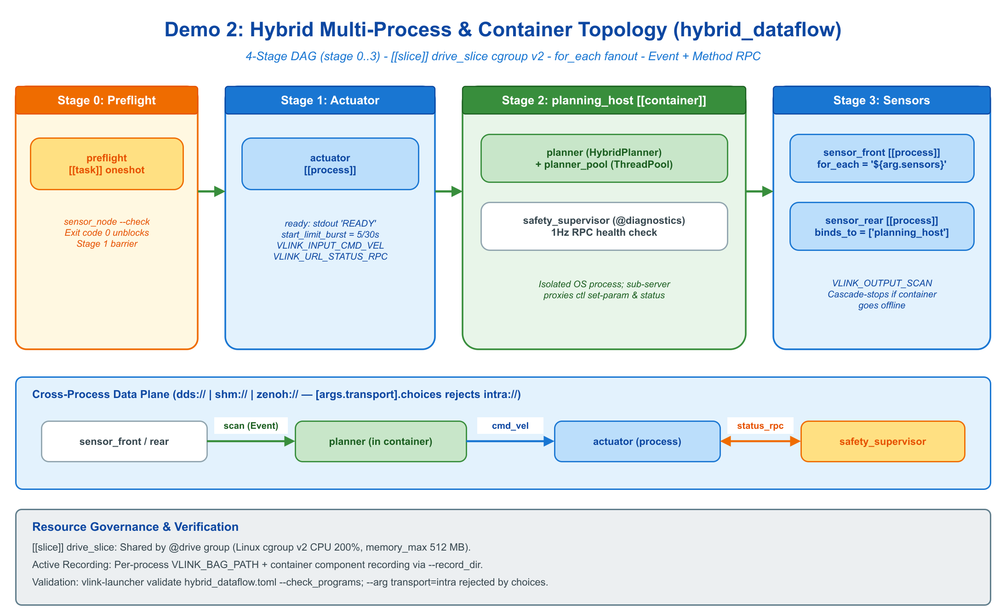

# Demo 2：多进程 + 隔离容器插件 + 资源治理混合编排栈（`hybrid_dataflow`）

本示例通过 [hybrid_dataflow.toml](hybrid_dataflow.toml) 编排外部独立进程（[sensor_node.cc](sensor_node.cc)、[actuator_node.cc](actuator_node.cc)）与故障隔离容器内的插件组件（[planner_plugin.cc](planner_plugin.cc)），完整演示 **$O(N)$ 分层启动屏障（`stage 0..3`）**、**`for_each` 模板扇出**、**`[[slice]]` cgroup v2 资源治理**、**环境变量自动注入** 与 **Event + Method RPC 混合跨进程数据流**。



> 架构图源文件：[images/hybrid-dataflow-topology.drawio](images/hybrid-dataflow-topology.drawio)

---

## 4 阶段启动链路与单元说明

| 阶段 | 单元名 | 单元类型 | 所属组 / 切片 | 关键机制 |
| --- | --- | --- | --- | --- |
| Stage 0 | `preflight` | `[[task]]` (`oneshot`) | `@drive` / `drive_slice` | 启动前执行 `example_launcher_sensor_node --check`，退出码 0 后放行 Stage 1 |
| Stage 1 | `actuator` | `[[process]]` | `@drive` / `drive_slice` | 订阅 `cmd_vel` 并暴露 `status_rpc`（`vlink::Server`）；`stdout` 就绪探针 + `start_burst = 5 / 30s` 熔断 |
| Stage 2 | `planning_host` | `[[container]]` | `@drive` / `drive_slice` | 故障隔离宿主进程，内部托管 `planner`（`HybridPlanner`，`planner_pool` 卸载计算）与 `safety_supervisor`（`SafetySupervisor`，`@diagnostics` 组，每秒 RPC 探活并调用 `ctx.report_health()`） |
| Stage 3 | `sensor_front`<br>`sensor_rear` | `[[process]]` (`for_each`) | `@drive` / `drive_slice` | 由 `for_each = "${arg.sensors}"` 自动扇出展开；`binds_to = ["planning_host"]` 确保容器停机时级联停止传感器 |

### 环境变量自动注入映射

外部进程无需在代码中硬编码通道地址，Launcher 会依据 TOML 声明自动注入环境变量（同时支持 CLI `--in` / `--out` / `--rpc` 覆盖）：

| TOML 声明 | 自动注入环境变量 | 消费者 |
| --- | --- | --- |
| `[process.outputs] scan = ...` | `VLINK_OUTPUT_SCAN` | `sensor_front` / `sensor_rear` |
| `[process.inputs] cmd_vel = ...` | `VLINK_INPUT_CMD_VEL` | `actuator` |
| `[process.urls] status_rpc = ...` | `VLINK_URL_STATUS_RPC` | `actuator` |

---

## 构建

- **整仓构建**：见上级 [examples/launcher/README.md](../README.md)。
- **独立构建**：

```bash
cmake -B build -DCMAKE_BUILD_TYPE=Release
cmake --build build -j
```

构建产物：`example_launcher_sensor_node`、`example_launcher_actuator_node`、`example_launcher_planner_plugin` 动态库与同级 `hybrid_dataflow.toml`。

---

## 运行与验证实验

进入产物目录（如 `build/output/bin`）后执行：

### 1. 静态校验与参数 / 跨进程 `intra://` 检查

```bash
# 校验可执行文件存在性、模板展开与依赖无环
./vlink-launcher validate hybrid_dataflow.toml --check_programs
./vlink-launcher graph hybrid_dataflow.toml --format ascii

# 传入跨进程不可用的 intra://：触发 [args.transport].choices 枚举校验直接报错拒绝
# （若清单未配 choices，validate 亦会对跨 OS 进程的 intra:// 数据流边发出静态告警）
./vlink-launcher validate hybrid_dataflow.toml --arg transport=intra
```

### 2. 启动混合栈（可动态扩展传感器扇出数量）

```bash
# 默认使用 dds://，展开 front + rear 两路外部传感器进程
./vlink-launcher run hybrid_dataflow.toml

# 切换为 shm:// 或 zenoh://，并动态扩展为 3 路传感器扇出
./vlink-launcher run hybrid_dataflow.toml --arg transport=shm --arg sensors=front,rear,left
```

### 3. 实时观测 cgroup 切片、健康上报与在线调参

本清单的控制面命名空间为 `hybrid_launcher`，另开终端执行：

```bash
# 实时 TUI 仪表盘（可观察每个进程的 PID、CPU、RSS 与 cgroup 内存）
./vlink-launcher top --namespace hybrid_launcher

# 查看容器内安全监控组件的 RPC 健康上报详情
./vlink-launcher ctl --namespace hybrid_launcher status safety_supervisor

# 动态修改隔离容器内 HybridPlanner 的最高限速（经控制面透明转发至容器）
./vlink-launcher ctl --namespace hybrid_launcher set-param -u planner max_speed_mps=2.5

# 查看完整关键启动路径与耗时排名
./vlink-launcher ctl --namespace hybrid_launcher critical-chain sensor_front
./vlink-launcher ctl --namespace hybrid_launcher blame
```
